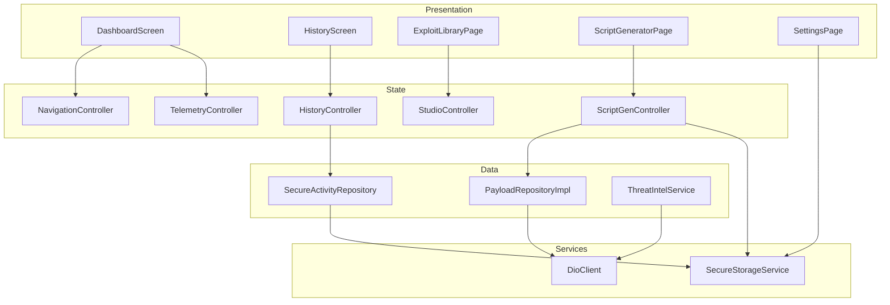
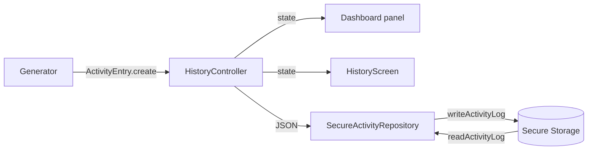

# TAHAP 3 — Implementasi Aplikasi dengan Flutter

**Proyek:** PayloadHub-AI
**Stack:** Flutter/Dart (klien) + FastAPI/Python (backend agent)
**Target MVP:** fungsi utama berjalan: generator payload tervalidasi, navigasi adaptif, pengelolaan konfigurasi dan riwayat lokal.

---

## 1. Ringkasan Implementasi

| Aspek | Implementasi |
|---|---|
| Framework klien | Flutter 3.47.2 (stable), Dart 3.13 |
| State management | Riverpod 2.x (`StateNotifierProvider`, `Provider`) |
| HTTP klien | Dio 5.x dengan `DioClient` |
| Penyimpanan aman | `flutter_secure_storage` 9.x (Android Keystore / EncryptedSharedPreferences) |
| Penyorotan kode | `flutter_highlight` + `highlight` |
| Backend | FastAPI + Pydantic + LangChain-style agent |
| Build | Android APK (`flutter build apk --release`), Web (`flutter build web`) |
| Pengujian | `flutter analyze` bersih; 16 pengujian otomatis lulus |

## 2. Struktur Proyek

```text
payloadhub-ai/
├── backend/
│   ├── app/
│   │   ├── main.py          # FastAPI app, endpoint agent/ExploitDB/VirusTotal
│   │   ├── models.py        # Pydantic + validasi/sanitasi
│   │   ├── agent.py         # prompt sistem + orkestrasi tool
│   │   ├── tools.py         # library payload + tool deterministik
│   │   ├── exploitdb.py     # pencarian katalog ExploitDB
│   │   ├── virustotal.py    # integrasi threat intelligence
│   │   └── config.py        # environment settings
│   ├── requirements.txt
│   └── .env.example
├── frontend/
│   ├── lib/
│   │   ├── main.dart
│   │   ├── core/
│   │   │   ├── error/app_exception.dart
│   │   │   ├── network/dio_client.dart
│   │   │   ├── theme/app_theme.dart
│   │   │   └── utils/validators.dart
│   │   ├── services/
│   │   │   ├── secure_storage_service.dart
│   │   │   ├── free_chatbot_service.dart
│   │   │   └── auto_key_loader.dart
│   │   └── features/
│   │       ├── dashboard/       # shell, panel, controller, halaman
│   │       ├── payload_chat/    # entity, repository, model API
│   │       └── history/         # model, repository, controller, layar
│   ├── test/                    # 16 pengujian otomatis
│   ├── android/                 # konfigurasi Android (manifest, Gradle)
│   └── pubspec.yaml
├── docs/                        # laporan Tahap 1–5, wireframe, purwarupa
├── BLUEPRINT.md
└── README.md
```

## 3. Arsitektur Lapisan



**Pemisahan tanggung jawab:**

- **Presentation** hanya menangani tampilan dan interaksi; tidak memanggil HTTP langsung.
- **Controller/Notifier** menyimpan state dan memanggil repository.
- **Data/Repository** mengabstraksi sumber data (API atau secure storage), sehingga dapat diganti *fake* saat pengujian.
- **Services** menyediakan kemampuan lintas fitur (HTTP, penyimpanan aman, chatbot).
- **Core** berisi tema, validator, dan penanganan error yang dipakai bersama.

## 4. Implementasi Antarmuka

### 4.1 Shell adaptif

`DashboardScreen` memilih navigasi berdasarkan lebar layar:

```dart
final compact = MediaQuery.sizeOf(context).width < 700;
// ...
Row(
  children: [
    if (!compact) const AppSidebar(),
    Expanded(child: /* top bar + halaman + footer */),
  ],
)
// ...
if (compact) _MobileNavigation(...)
```

- **Layar < 700 px:** bottom navigation 5 tab, tanpa sidebar, footer disembunyikan, `SafeArea` aktif.
- **Layar ≥ 700 px:** sidebar 228 px + konten.
- **Halaman:** `IndexedStack` agar state tidak hilang saat berpindah tab.

### 4.2 Dashboard responsif

- **< 1000 px:** satu kolom gulir vertikal berisi Studio → Nmap → Aktivitas → Library → Threat → Monitoring. Tidak ada *horizontal scroll*.
- **≥ 1000 px:** tiga kolom (6:4:3) dengan masing-masing kolom dapat digulir.

### 4.3 Halaman dan komponen utama

| File | Tanggung jawab |
|---|---|
| `app_top_bar.dart` | Judul halaman + aksi riwayat/ekspor/tentang yang berfungsi |
| `app_sidebar.dart` | Menu desktop + pintasan riwayat |
| `panel_card.dart` | Kartu konsisten (judul, subtitle, aksi) |
| `script_generator_page.dart` | Tab generator, validasi form, simpan riwayat |
| `exploit_library_page.dart` | Daftar + detail desktop; daftar → rute detail di ponsel |
| `history_panel.dart` | Ringkasan 4 aktivitas terbaru + tautan "Lihat semua" |
| `history_screen.dart` | Daftar riwayat, *swipe delete*, *bottom sheet*, ekspor |
| `settings_page.dart` | API key, target default responsif, engine, toggle |
| `floating_chatbot.dart` | Info Bot *overlay* |
| `payload_code_view.dart` | Blok kode + *syntax highlighting* + salin |

### 4.4 Prinsip tampilan yang diterapkan

- `SafeArea` menjaga konten dari *notch* dan status bar.
- `MediaQuery.sizeOf` (bukan `MediaQuery.of`) agar rebuild lebih efisien.
- Warna dan tipografi terpusat di `app_theme.dart`.
- `Material` + `InkWell` untuk umpan balik sentuh (memperbaiki assertion `ListTile`).
- Target sentuh tombol ikon 34×34 dengan padding, tombol utama tinggi 44–46.

## 5. Navigasi Antarhalaman

| Mekanisme | Contoh | Kode |
|---|---|---|
| Tab persisten | Home ↔ Exploit ↔ Generator ↔ Monitor ↔ Settings | `NavigationBar`/`AppSidebar` → `NavigationController.select` |
| Rute bertumpuk | Detail exploit di ponsel | `Navigator.push(MaterialPageRoute(...))` |
| Rute bertumpuk | Riwayat aktivitas | `openHistory(context)` di `history_panel.dart` |
| Overlay | Info Bot, detail riwayat | `showModalBottomSheet` / widget `Positioned` |
| Aksi lintas halaman | Send to Studio | `ref.read(studioProvider.notifier).applyExploit(...)` + `nav.select(AppPage.dashboard)` |
| Kembali | Tombol back sistem / `AppBar` | `Navigator.pop` |
| Umpan balik | Sukses generate, gagal validasi | `SnackBar`, pesan error form |

## 6. Pengelolaan Masukan Pengguna dan Validasi

### 6.1 Validasi klien

`core/utils/validators.dart` memakai regex IPv4 ketat (menolak *leading zero* dan oktet > 255) serta rentang port 1–65535:

```dart
bool isValidIpv4(String value) => ipv4Pattern.hasMatch(value.trim());

bool isValidPort(String value) {
  final port = int.tryParse(value.trim());
  return port != null && port >= 1 && port <= 65535;
}
```

Diterapkan pada:

- **Generator one-liner:** `TextFormField` + `Form.validate()`; LHOST/LPORT wajib valid untuk kategori *Reverse Shell*; input port hanya menerima digit (`FilteringTextInputFormatter.digitsOnly`).
- **Python builder:** target IP/port divalidasi bila diisi.
- **Settings:** LHOST/LPORT divalidasi sebelum disimpan.
- **Backend:** validasi ganda di Pydantic (`models.py`) dan di setiap tool.

### 6.2 Sanitasi server

```python
_SANITIZE_RE = re.compile(r"[^\x20-\x7E\n\r\t]")

def sanitize_text(value: str, max_len: int) -> str:
    cleaned = _SANITIZE_RE.sub("", value).strip()
    return cleaned[:max_len]
```

- `prompt`: 1–4000 karakter.
- `scan_data`: maksimum 20.000 karakter.
- `lhost`: harus IPv4 valid.
- `lport`: 1–65535.
- `target_os`: enum `linux|windows|unknown`.

### 6.3 Pesan kesalahan

| Kondisi | Perilaku UI |
|---|---|
| LHOST kosong/tidak valid | `IP address is required` / `Enter a valid IPv4 address` |
| Port kosong/keluar rentang | `Port is required` / `Port must be between 1 and 65535` |
| Backend mati | SnackBar/error teks pada kartu hasil |
| API mengembalikan 400 | Pesan detail dari `ErrorResponse` |
| API mengembalikan 500 | Pesan umum + saran periksa log backend |
| Riwayat gagal disimpan | Banner error di halaman riwayat, data tetap di memori |

## 7. Pengelolaan Data

### 7.1 Riwayat aktivitas (fitur baru Tahap 3)

Alur:



Karakteristik:

- Maksimum **40 entri**; entri terlama dibuang otomatis.
- Penulisan diserialkan melalui antrean (`_writeQueue`) agar dua aksi cepat tidak saling menimpa.
- JSON rusak tidak membuat aplikasi gagal; repository mengembalikan daftar kosong.
- Operasi: tambah, hapus per entri (*swipe*), hapus semua (dengan konfirmasi), ekspor JSON ke clipboard.
- Data ditampilkan di dua tempat: panel dashboard (4 terbaru) dan halaman riwayat.

### 7.2 Konfigurasi pengguna

Disimpan melalui `SecureStorageService`:

- API key provider (OpenAI, DeepSeek, Gemini, Shodan, VirusTotal).
- Default LHOST/LPORT (dipakai otomatis oleh generator dan Studio).
- Base URL backend, engine LLM, preferensi UI.
- `clearAll()` menghapus seluruh kredensial.

### 7.3 Data dari backend

- `PayloadRepositoryImpl` mengirim `POST /api/v1/agent/execute` dan memetakan `AgentResponse` → `ChatMessage`.
- `ThreatIntelService` memanggil endpoint VirusTotal dan menangani status key belum diatur.
- `ExploitDbItem` dipetakan dari respons pencarian ExploitDB.

### 7.4 Telemetri

`TelemetryController` menghasilkan data simulasi (*random walk* dengan seed) setiap detik untuk menggerakkan grafik. Data ini **bukan** metrik host nyata dan diberi keterangan pada dokumentasi.

## 8. Fitur Utama dan Titik Implementasi

| Fitur | Implementasi | Status |
|---|---|---|
| One-liner deterministik | `ScriptGenController.buildOneLiner` + template di `_reverseShell`, `_webShell`, `_privesc` | Berjalan offline |
| Exploit Python via agent | `buildPythonExploit` → `PayloadRepositoryImpl.execute` | Butuh backend + API key |
| Validasi input | `validators.dart`, `TextFormField.validator`, Pydantic | Berjalan |
| Generator → riwayat | `historyProvider.add` setelah generate | Berjalan |
| Riwayat persisten | `SecureActivityRepository` + `SecureStorageService` | Berjalan |
| Navigasi adaptif | `DashboardScreen`, `_MobileNavigation`, `AppSidebar` | Berjalan |
| Detail exploit di ponsel | `_ExploitDetailScreen` | Berjalan |
| Salin kode | `PayloadCodeView` / `Clipboard.setData` | Berjalan |
| Peringatan etika | Dialog *About* + README + notice | Berjalan |
| Ekspor riwayat | Ikon simpan di top bar → JSON clipboard | Berjalan |

## 9. Konfigurasi Android

| Berkas | Perubahan | Alasan |
|---|---|---|
| `android/app/src/main/AndroidManifest.xml` | `INTERNET`, label `PayloadHub-AI`, `usesCleartextTraffic` | Akses backend HTTP di jaringan lokal |
| `android/app/build.gradle` | `applicationId = id.farrel.payloadhubai`, komentar signing | Identitas aplikasi & kejelasan build |
| `android/gradle/wrapper/gradle-wrapper.properties` | Gradle 8.14.3 | Memenuhi minimum Flutter 3.47 |
| `android/settings.gradle` | AGP 8.11.1, Kotlin 2.1.0 | Kompatibel dengan Gradle 8.14 dan Java 17–20 |

> **Catatan build:** Gradle 8.14 + AGP 8.11 membutuhkan JDK 17–20. Pada mesin pengembangan dipakai JDK 20 melalui `flutter config --jdk-dir`. Untuk distribusi publik, ganti `signingConfigs.debug` dengan keystore rilis.

## 10. Cara Menjalankan

### 10.1 Backend

```bash
cd backend
python -m venv .venv
# Windows: .venv\Scripts\activate
source .venv/bin/activate
pip install -r requirements.txt
cp .env.example .env   # isi LLM_API_KEY
uvicorn app.main:app --reload --host 0.0.0.0 --port 8000
```

Verifikasi: `curl http://127.0.0.1:8000/healthz` → `{"status":"ok"}`.

### 10.2 Frontend

```bash
cd frontend
flutter pub get
flutter run -d chrome          # cepat untuk demo
flutter run -d <android-id>    # perangkat/emulator
```

- Emulator Android mengakses host melalui `http://10.0.2.2:8000`.
- Perangkat fisik: ubah `defaultBaseUrl` ke IP LAN komputer.

### 10.3 Build kandidat

```bash
flutter analyze
flutter test
flutter build apk --release
# hasil: build/app/outputs/flutter-apk/app-release.apk
```

## 11. Dokumentasi Perkembangan (ringkas)

| Tanggal | Perubahan | Bukti |
|---|---|---|
| Awal proyek | Struktur awal Flutter + backend, dashboard desktop | commit `9b11114` |
| Tahap 3 | Layout dashboard mobile satu kolom; bottom nav + SafeArea | `dashboard_screen.dart` |
| Tahap 3 | Riwayat aktivitas lokal terenkripsi + panel + halaman | `features/history/**` |
| Tahap 3 | Validasi form one-liner + prefill LHOST/LPORT dari Settings | `script_generator_page.dart` |
| Tahap 3 | Detail exploit menjadi rute penuh di ponsel | `exploit_library_page.dart` |
| Tahap 3 | Perbaikan assertion `ListTile` dan API usang | `settings_page.dart`, `floating_chatbot.dart` |
| Tahap 3 | Manifest rilis + modernisasi Gradle/AGP | `android/**` |

## 12. Status Verifikasi

| Klaim | Status | Bukti |
|---|---|---|
| `flutter analyze` tanpa issue | **[C]** | `No issues found!` |
| 16 pengujian lulus | **[C]** | `flutter test` |
| Riwayat bertahan setelah restart | **[I]** | Diuji melalui *fake* penyimpanan dan alur repository; uji perangkat fisik menyusul |
| APK rilis terbangun | **[C]/[S]** | Lihat Tahap 4/5 untuk status build final |
| Data telemetri simulasi | **[C]** | `telemetry_controller.dart` |

**VERDICT: approve** — MVP terimplementasi dengan pemisahan lapisan, validasi, navigasi, dan pengelolaan data lokal.
