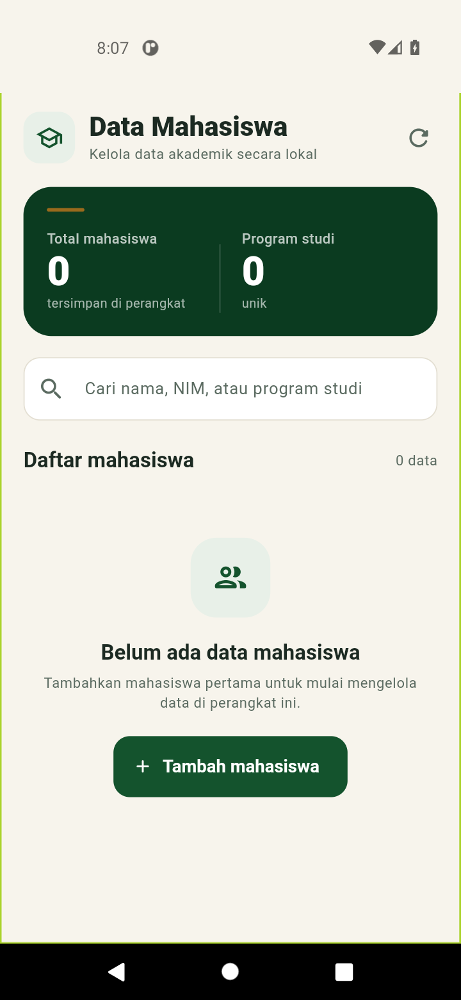
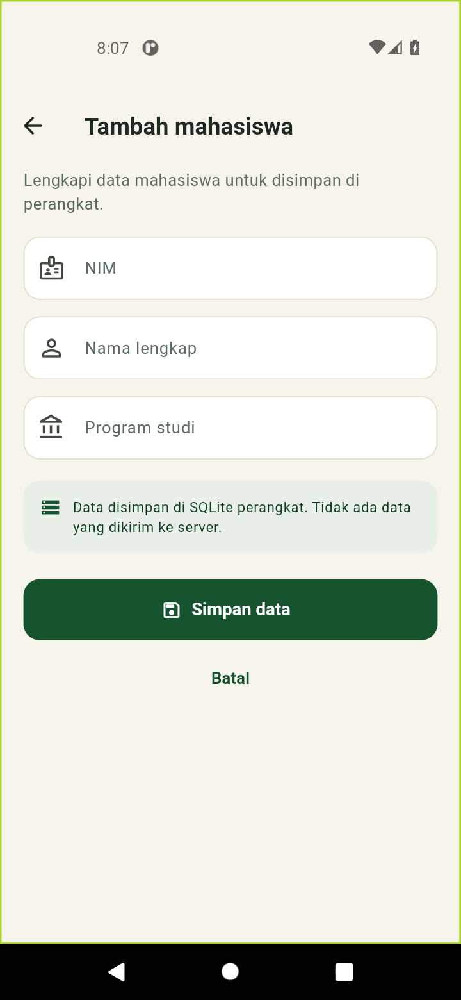
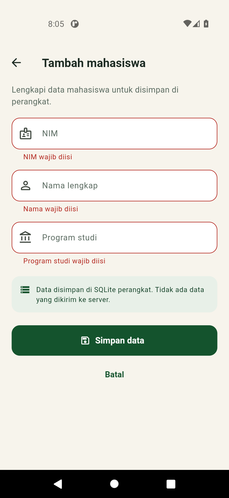
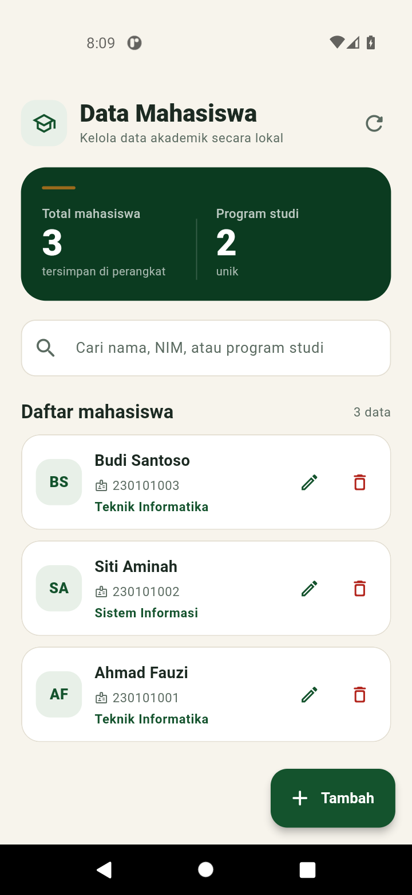
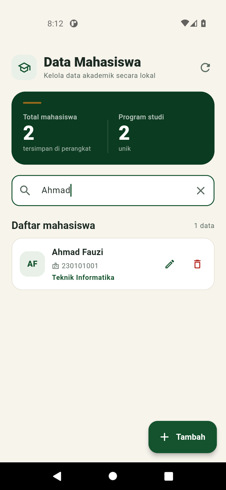
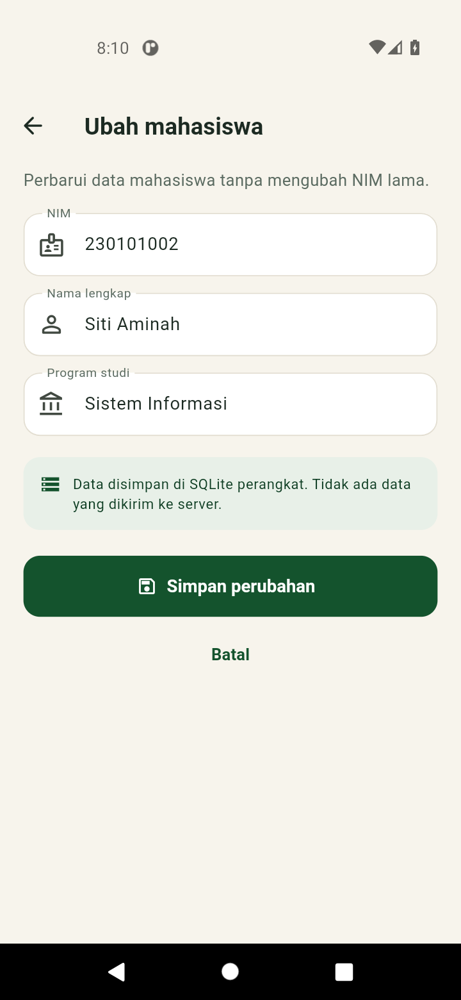
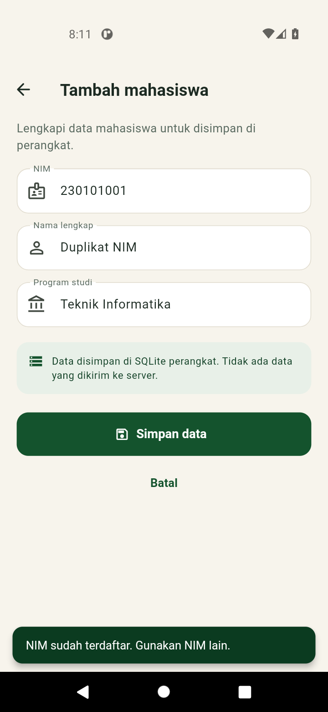
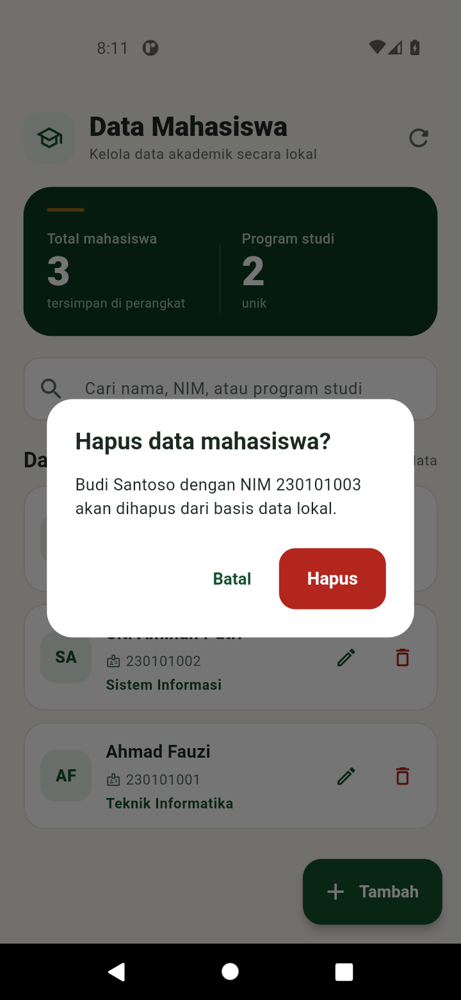
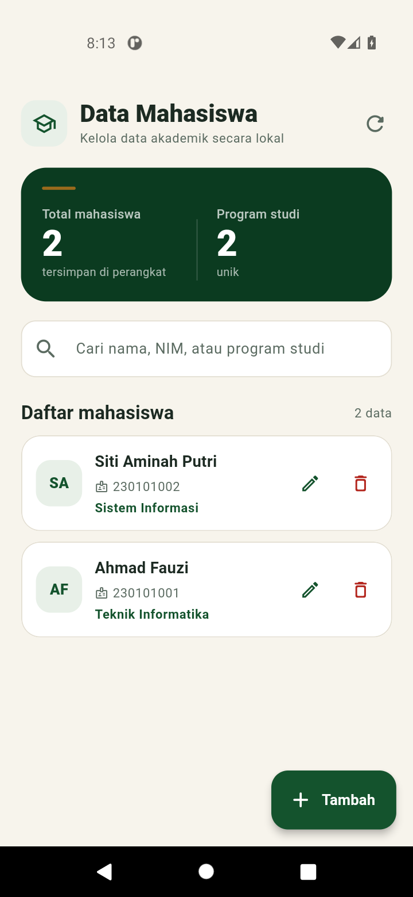

<!-- cover -->
# MOBILE PROGRAMMING (E)

## Tugas Pertemuan 11: CRUD Data Mahasiswa dengan Flutter dan SQLite

**Laporan Tugas Kelompok**

**Dosen Pengampu:**

**SUPRIYONO, M.Kom**

**Asisten Dosen:**

**LINDA SALMA ANGGREANI, M.T**


**Disusun oleh:**

**Farrel Faiziaulhaq Azmi (240605110176)**

**Naufal Ghali Rahadi (240605110161)**

**Mochammad Agus Rozakhy (240605110262)**

**PROGRAM STUDI TEKNIK INFORMATIKA**

**FAKULTAS SAINS DAN TEKNOLOGI**

**UNIVERSITAS ISLAM NEGERI MAULANA MALIK IBRAHIM MALANG**

**2026**
<!-- /cover -->

# KATA PENGANTAR

Puji syukur kami sampaikan kepada Allah SWT karena laporan Tugas Pertemuan 11
mata kuliah Mobile Programming dapat diselesaikan. Laporan ini membahas
pembangunan aplikasi CRUD Data Mahasiswa menggunakan Flutter dan SQLite,
mulai dari perancangan, implementasi, hingga pengujian pada emulator Android.

Aplikasi dibuat untuk memenuhi kebutuhan praktikum pengelolaan data lokal.
Data mahasiswa disimpan di perangkat, sehingga aplikasi tetap dapat membaca
dan mengubah data tanpa koneksi internet. Laporan ini juga memuat bukti
pengujian berupa tangkapan layar yang diambil langsung dari aplikasi yang
berjalan, bukan gambar ilustrasi.

Kami mengucapkan terima kasih kepada dosen pengampu, asisten dosen, dan
seluruh pihak yang membantu proses pengerjaan. Kami menyadari laporan ini
masih memiliki kekurangan. Kritik dan saran yang membangun akan kami
gunakan untuk perbaikan berikutnya.

Malang, 22 November 2026

Kelompok CRUD Mahasiswa

<!-- pagebreak -->

# DAFTAR ISI

1. KATA PENGANTAR
2. DAFTAR ISI
3. BAB I PENDAHULUAN
4. BAB II LANDASAN TEORI
5. BAB III PERANCANGAN APLIKASI
6. BAB IV IMPLEMENTASI
7. BAB V HASIL DAN PEMBAHASAN
8. BAB VI KESIMPULAN DAN SARAN
9. DAFTAR PUSTAKA
10. LAMPIRAN

<!-- pagebreak -->

# BAB I PENDAHULUAN

## 1.1 Latar Belakang

Pengelolaan data mahasiswa merupakan kebutuhan dasar di lingkungan akademik.
Pencatatan manual pada buku atau berkas terpisah menyulitkan pencarian,
pembaruan, dan penghapusan data. Aplikasi mobile dengan basis data lokal
memberikan solusi yang praktis karena data dapat diakses langsung dari
perangkat tanpa bergantung pada koneksi internet.

Flutter memungkinkan pembuatan antarmuka mobile yang konsisten, sedangkan
SQLite menyediakan basis data relasional ringan yang tersimpan di perangkat.
Kombinasi keduanya sesuai untuk aplikasi CRUD berskala kecil seperti data
mahasiswa. Pada praktikum ini, aplikasi dibangun untuk melatih alur Create,
Read, Update, dan Delete, validasi input, serta penanganan kesalahan basis
data.

## 1.2 Rumusan Masalah

1. Bagaimana membangun aplikasi CRUD data mahasiswa dengan Flutter dan SQLite?
2. Bagaimana memvalidasi input serta mencegah NIM ganda?
3. Bagaimana memastikan data tetap tersimpan setelah aplikasi ditutup?
4. Bagaimana menampilkan kondisi kosong, loading, error, dan hasil pencarian
   dengan jelas?

## 1.3 Tujuan

1. Menghasilkan aplikasi Android untuk mengelola data mahasiswa.
2. Menerapkan operasi CRUD dengan tabel SQLite dan library `sqflite`.
3. Menerapkan validasi NIM, nama, dan program studi.
4. Menangani NIM duplikat melalui constraint `UNIQUE` dan pesan yang mudah
   dipahami.
5. Menyediakan bukti pengujian end-to-end berupa screenshot asli dari
   emulator.

## 1.4 Manfaat

Bagi mahasiswa, aplikasi ini menjadi latihan menerapkan Flutter, Dart,
SQLite, dan pola CRUD dalam satu proyek. Bagi pengguna, aplikasi memberi cara
sederhana untuk menyimpan dan mencari data mahasiswa secara lokal. Bagi
pembaca, laporan ini dapat menjadi referensi penerapan `sqflite` pada
aplikasi mobile.

## 1.5 Batasan Masalah

- Aplikasi dijalankan pada Android melalui emulator atau perangkat fisik.
- Basis data hanya berisi satu tabel, yaitu `mahasiswa`.
- Data disimpan lokal dan belum memiliki sinkronisasi ke server.
- Aplikasi belum memiliki autentikasi, hak akses, atau multi-pengguna.
- Fitur ekspor dan impor data belum disediakan.

## 1.6 Anggota Kelompok

| Nama | NIM |
|---|---|
| Farrel Faiziaulhaq Azmi | 240605110176 |
| Naufal Ghali Rahadi | 240605110161 |
| Mochammad Agus Rozakhy | 240605110262 |

<!-- pagebreak -->

# BAB II LANDASAN TEORI

## 2.1 Flutter

Flutter adalah framework antarmuka buatan Google yang menggunakan bahasa
Dart. Flutter menyusun tampilan dari widget dan menyediakan rendering sendiri,
sehingga aplikasi dapat berjalan di Android, iOS, web, dan desktop. Pada
proyek ini, Flutter digunakan untuk membangun antarmuka mobile dengan
Material 3.

## 2.2 Dart

Dart adalah bahasa pemrograman berorientasi objek yang dipakai Flutter.
Dart mendukung null safety, async/await, dan tipe data statis. Null safety
penting pada pemetaan data dari SQLite karena kolom `id` dapat bernilai null
sebelum baris disimpan.

## 2.3 SQLite

SQLite adalah basis data relasional yang tertanam di aplikasi. SQLite tidak
memerlukan server terpisah dan menyimpan data dalam satu berkas. Pada Android,
SQLite tersedia melalui API bawaan dan dapat diakses dari Flutter melalui
plugin `sqflite`.

## 2.4 sqflite

`sqflite` adalah plugin Flutter untuk membuka, membaca, dan menulis basis data
SQLite di Android dan iOS. Plugin ini menyediakan operasi `insert`, `query`,
`update`, dan `delete`. Versi yang digunakan pada proyek ini adalah `2.4.6`.

## 2.5 Operasi CRUD

CRUD merupakan empat operasi dasar pengelolaan data:

| Operasi | Fungsi pada aplikasi |
|---|---|
| Create | Menambah data mahasiswa baru |
| Read | Menampilkan dan mencari daftar mahasiswa |
| Update | Mengubah nama atau program studi |
| Delete | Menghapus data setelah konfirmasi |

## 2.6 Validasi dan Constraint

Validasi di sisi aplikasi mencegah data kosong atau NIM yang tidak sesuai
format. Validasi di sisi basis data menjaga keunikan NIM melalui constraint
`UNIQUE`. Jika NIM yang sama disimpan dua kali, SQLite menolak operasi dan
aplikasi menampilkan pesan "NIM sudah terdaftar. Gunakan NIM lain."

## 2.7 Material 3

Material 3 menyediakan komponen, warna, tipografi, dan pedoman interaksi.
Aplikasi menggunakan tema terang dengan warna hijau tua sebagai warna utama,
latar krem hangat, dan aksen emas. Warna hijau dipilih untuk memberi kesan
akademik dan keterhubungan dengan identitas kampus, sedangkan aksen emas
dipakai terbatas pada penanda kecil agar hierarki tetap jelas.

<!-- pagebreak -->

# BAB III PERANCANGAN APLIKASI

## 3.1 Deskripsi Aplikasi

CRUD Mahasiswa adalah aplikasi Android untuk mencatat data mahasiswa.
Pengguna dapat menambah data, melihat daftar, mencari berdasarkan nama, NIM,
atau program studi, mengubah data, dan menghapus data. Seluruh data disimpan
di SQLite perangkat.

## 3.2 Alur Pengguna

| Langkah | Aksi pengguna | Respons aplikasi |
|---|---|---|
| 1 | Membuka aplikasi | Memuat data dari SQLite |
| 2 | Menekan Tambah | Membuka form kosong |
| 3 | Mengisi form | Menampilkan validasi saat input berubah |
| 4 | Menekan Simpan data | Menyimpan ke SQLite dan kembali ke daftar |
| 5 | Menekan ikon edit | Membuka form dengan data terisi |
| 6 | Menekan Simpan perubahan | Memperbarui baris dan memuat ulang daftar |
| 7 | Menekan ikon hapus | Menampilkan dialog konfirmasi |
| 8 | Menekan Hapus | Menghapus baris dan memperbarui daftar |

## 3.3 Arsitektur Aplikasi

```text
Widget (List/Form)
      |
      v
DatabaseHelper (singleton)
      |
      v
sqflite
      |
      v
SQLite: mahasiswa.db
```

Lapisan tampilan tidak menulis SQL secara langsung. Semua operasi basis data
dipusatkan di `DatabaseHelper` agar kode lebih mudah dirawat dan diuji.

## 3.4 Struktur Folder

```text
crud_mahasiswa/
├── lib/
│   ├── main.dart
│   ├── database/database_helper.dart
│   ├── models/mahasiswa.dart
│   ├── screens/mahasiswa_form_page.dart
│   ├── screens/mahasiswa_list_page.dart
│   ├── theme/app_theme.dart
│   └── utils/validators.dart
├── test/
│   ├── form_test.dart
│   └── mahasiswa_test.dart
└── pubspec.yaml
```

## 3.5 Skema Basis Data

```sql
CREATE TABLE mahasiswa (
  id INTEGER PRIMARY KEY AUTOINCREMENT,
  nim TEXT NOT NULL UNIQUE,
  nama TEXT NOT NULL,
  prodi TEXT NOT NULL
);
```

Indeks tambahan dibuat pada kolom `nama` untuk membantu pencarian dan
pengurutan:

```sql
CREATE INDEX idx_mahasiswa_nama ON mahasiswa(nama);
```

## 3.6 Rancangan Antarmuka

| Halaman | Elemen utama | Tujuan |
|---|---|---|
| Daftar | Header, ringkasan, pencarian, kartu data, tombol tambah | Melihat dan mencari data |
| Form tambah | Tiga field, catatan penyimpanan, tombol simpan | Memasukkan data baru |
| Form ubah | Field terisi, tombol simpan perubahan | Memperbarui data |
| Dialog hapus | Nama dan NIM, tombol batal dan hapus | Mencegah penghapusan tidak sengaja |
| Kondisi kosong | Ikon, penjelasan, tombol tambah | Memberi langkah berikutnya |
| Kondisi error | Pesan dan tombol coba lagi | Memulihkan kegagalan baca data |

Prinsip tampilan yang dipakai:

- Satu fokus utama per layar, yaitu ringkasan data pada halaman daftar dan
  form pada halaman tambah atau ubah.
- Target sentuh tombol minimal 44 dp dan jarak antar elemen konsisten.
- Warna teks memenuhi kontras pada latar terang.
- Tidak ada tautan atau tombol tanpa fungsi.
- Kondisi kosong, loading, error, dan hasil pencarian kosong ditangani.

<!-- pagebreak -->

# BAB IV IMPLEMENTASI

## 4.1 Lingkungan Pengembangan

| Komponen | Versi atau keterangan |
|---|---|
| Flutter | 3.47.2 stable |
| Dart | 3.13.2 |
| sqflite | 2.4.6 |
| path | 1.9.1 |
| Android | 11 (API 30), emulator Pixel 5 |
| Resolusi uji | 720 x 1560 piksel, density 293 |
| IDE | Visual Studio Code dan Android SDK |
| Bahasa | Dart |

## 4.2 Dependency

Proyek dibuat dengan perintah berikut:

```bash
flutter create crud_mahasiswa
cd crud_mahasiswa
flutter pub add sqflite path
```

Dependency yang dipakai:

```yaml
dependencies:
  flutter:
    sdk: flutter
  sqflite: ^2.4.6
  path: ^1.9.1
```

## 4.3 Model Mahasiswa

`Mahasiswa` memetakan kolom SQLite ke objek Dart. Tipe `id` dibuat nullable
karena data baru belum memiliki id.

```dart
class Mahasiswa {
  const Mahasiswa({
    this.id,
    required this.nim,
    required this.nama,
    required this.prodi,
  });

  final int? id;
  final String nim;
  final String nama;
  final String prodi;

  Map<String, Object?> toMap() => {
        'id': id,
        'nim': nim,
        'nama': nama,
        'prodi': prodi,
      };

  factory Mahasiswa.fromMap(Map<String, Object?> map) {
    return Mahasiswa(
      id: map['id'] as int?,
      nim: map['nim'] as String,
      nama: map['nama'] as String,
      prodi: map['prodi'] as String,
    );
  }
}
```

## 4.4 DatabaseHelper

`DatabaseHelper` adalah singleton yang membuka basis data satu kali dan
menyediakan operasi CRUD.

```dart
Future<Database> get database async {
  final existing = _database;
  if (existing != null) return existing;

  final dbPath = await getDatabasesPath();
  final opened = await openDatabase(
    join(dbPath, 'mahasiswa.db'),
    version: 1,
    onCreate: (db, version) async {
      await db.execute('''
        CREATE TABLE mahasiswa (
          id INTEGER PRIMARY KEY AUTOINCREMENT,
          nim TEXT NOT NULL UNIQUE,
          nama TEXT NOT NULL,
          prodi TEXT NOT NULL
        )
      ''');
    },
  );
  _database = opened;
  return opened;
}

Future<int> insertMahasiswa(Mahasiswa mahasiswa) async {
  final db = await database;
  return db.insert('mahasiswa', mahasiswa.toMap());
}

Future<List<Mahasiswa>> getMahasiswa() async {
  final db = await database;
  final rows = await db.query('mahasiswa', orderBy: 'id DESC');
  return rows.map(Mahasiswa.fromMap).toList(growable: false);
}
```

Operasi `update` memakai `id` sebagai kunci, sedangkan `delete` menerima id
baris yang dipilih. Jika `id` null pada operasi update, helper melempar
`ArgumentError` agar kesalahan tidak lolos diam-diam.

## 4.5 Validasi Input

```dart
final RegExp _nimPattern = RegExp(r'^[0-9]{8,15}$');

String? validateNim(String? value) {
  final nim = value?.trim() ?? '';
  if (nim.isEmpty) return 'NIM wajib diisi';
  if (!_nimPattern.hasMatch(nim)) {
    return 'NIM harus 8 sampai 15 digit angka';
  }
  return null;
}
```

Nama wajib diisi dan minimal tiga karakter. Program studi wajib diisi.
Form memakai `AutovalidateMode.onUserInteraction` agar pesan kesalahan hilang
setelah pengguna memperbaiki input.

## 4.6 Alur Simpan dan Duplikasi NIM

```dart
try {
  if (_isEdit) {
    await _db.updateMahasiswa(data);
  } else {
    await _db.insertMahasiswa(data);
  }
  Navigator.of(context).pop(true);
} on DatabaseException catch (error) {
  final duplicate = error.toString().contains('UNIQUE');
  _showMessage(
    duplicate
        ? 'NIM sudah terdaftar. Gunakan NIM lain.'
        : 'Data gagal disimpan. Periksa kembali isian Anda.',
  );
}
```

Constraint `UNIQUE` pada kolom `nim` menjadi pengaman terakhir. Aplikasi tidak
hanya mengandalkan pengecekan di UI, sehingga data ganda tetap ditolak.

## 4.7 Daftar dan Pencarian

Halaman daftar memuat data melalui `Future`, lalu menyimpan hasil di state.
Pencarian dilakukan pada nama, NIM, dan program studi tanpa mengubah data
asli.

```dart
List<Mahasiswa> get _filtered {
  final query = _query.trim().toLowerCase();
  if (query.isEmpty) return _items;
  return _items.where((item) {
    return item.nama.toLowerCase().contains(query) ||
        item.nim.toLowerCase().contains(query) ||
        item.prodi.toLowerCase().contains(query);
  }).toList(growable: false);
}
```

Halaman ini memiliki empat kondisi: loading, error, kosong, dan daftar berisi.
Jika pencarian tidak menemukan data, pengguna mendapat pesan khusus dan tombol
untuk menghapus pencarian.

## 4.8 Hapus Data

Penghapusan selalu melewati dialog konfirmasi yang menyebut nama dan NIM.
Setelah pengguna menekan Hapus, baris dihapus dan daftar dimuat ulang.

```dart
final confirmed = await showDialog<bool>(...);
if (confirmed != true) return;
await _db.deleteMahasiswa(mahasiswa.id!);
await _loadData();
```

## 4.9 Menjalankan Aplikasi

```bash
flutter pub get
flutter devices
flutter run -d emulator-5554
```

Untuk membangun APK debug:

```bash
flutter build apk --debug
```

Aplikasi diuji pada emulator Android 11 dengan basis data SQLite lokal.

<!-- pagebreak -->

# BAB V HASIL DAN PEMBAHASAN

## 5.1 Metode Pengujian

Pengujian dilakukan langsung pada aplikasi yang berjalan di emulator Android
Pixel 5 API 30. Setiap langkah dijalankan melalui antarmuka aplikasi, lalu
layar diambil dengan `adb shell screencap`. Screenshot pada laporan ini berasal
dari aplikasi tersebut, bukan mockup atau gambar yang dihasilkan model.

Data uji dibuat melalui aplikasi:

| NIM | Nama | Program Studi |
|---|---|---|
| 230101001 | Ahmad Fauzi | Teknik Informatika |
| 230101002 | Siti Aminah | Sistem Informasi |
| 230101003 | Budi Santoso | Teknik Informatika |

## 5.2 Hasil Pengujian End-to-End

| No | Skenario | Tindakan | Hasil yang diharapkan | Status |
|---:|---|---|---|---|
| 1 | Tampilan awal | Buka aplikasi tanpa data | Kondisi kosong tampil | Lulus |
| 2 | Validasi kosong | Tekan Simpan data tanpa mengisi | Tiga pesan wajib isi muncul | Lulus |
| 3 | Create | Isi data Ahmad lalu simpan | Data muncul, SnackBar sukses | Lulus |
| 4 | Create tambahan | Tambah Siti dan Budi | Jumlah data menjadi 3 | Lulus |
| 5 | Read | Buka daftar | Nama, NIM, dan prodi tampil | Lulus |
| 6 | Search | Cari "Ahmad" | Hanya Ahmad yang tampil | Lulus |
| 7 | Update | Ubah Siti menjadi Siti Aminah Putri | Nama berubah, jumlah tetap | Lulus |
| 8 | Duplicate NIM | Simpan NIM 230101001 lagi | Pesan NIM sudah terdaftar | Lulus |
| 9 | Delete | Hapus Budi dan konfirmasi | Data Budi hilang, jumlah 2 | Lulus |
| 10 | Persistence | Tutup paksa lalu buka aplikasi | Dua data terakhir tetap ada | Lulus |

## 5.3 Bukti Screenshot



Gambar 5.1 menunjukkan kondisi kosong. Ringkasan menunjukkan nol mahasiswa
dan nol program studi. Tombol Tambah mahasiswa menjadi satu-satunya ajakan
bertindak pada layar ini.



Form tambah berisi NIM, nama lengkap, dan program studi. Catatan di bawah form
menjelaskan bahwa data disimpan di SQLite perangkat dan tidak dikirim ke
server.



Ketiga field menampilkan pesan kesalahan setelah tombol Simpan data ditekan.
Pesan berada tepat di bawah field yang bermasalah.



Gambar 5.4 memperlihatkan hasil Create. Ringkasan berubah menjadi tiga
mahasiswa dan dua program studi. Setiap kartu menampilkan inisial, nama, NIM,
program studi, serta tombol ubah dan hapus.



Pencarian "Ahmad" menyaring daftar menjadi satu hasil tanpa mengubah data di
basis data. Ikon silang digunakan untuk menghapus kata kunci.



Form ubah memuat data yang dipilih. Pengguna dapat memperbarui nama atau
program studi, lalu menekan Simpan perubahan.



NIM 230101001 yang sudah ada ditolak. Pesan "NIM sudah terdaftar. Gunakan NIM
lain." muncul di bagian bawah layar dan form tetap terbuka agar pengguna dapat
memperbaiki input.



Dialog menyebut nama dan NIM yang akan dihapus. Tombol Batal dan Hapus
mencegah penghapusan tidak sengaja.


Setelah Budi Santoso dihapus, jumlah data berubah dari tiga menjadi dua.
Ringkasan dan daftar langsung diperbarui.



Aplikasi ditutup paksa melalui `adb shell am force-stop`, lalu dibuka kembali.
Dua data terakhir masih tampil. Ini membuktikan data tersimpan di SQLite, bukan
hanya di memori.

## 5.4 Pengujian Otomatis

Perintah yang dijalankan:

```bash
flutter analyze
flutter test
```

Hasil:

```text
flutter analyze : No issues found!
flutter test    : 6 tests passed
```

| Berkas uji | Jumlah | Cakupan |
|---|---:|---|
| `test/mahasiswa_test.dart` | 4 | Serialisasi model dan validasi input |
| `test/form_test.dart` | 2 | Validasi form kosong dan form ubah |
| **Total** | **6** | Semua lulus |

## 5.5 Pembahasan

Operasi Create berjalan melalui `insertMahasiswa`. Operasi Read memakai
`getMahasiswa` dengan urutan id menurun. Operasi Update memakai id baris,
sedangkan Delete memakai id yang dipilih dan dialog konfirmasi. Constraint
`UNIQUE` terbukti menolak NIM ganda, baik dari sisi basis data maupun pesan
yang ditampilkan aplikasi.

Pemisahan `DatabaseHelper`, model, dan halaman membuat kode lebih mudah
dibaca. Halaman daftar tidak mengetahui detail SQL, sedangkan form hanya
memanggil operasi simpan atau ubah. Pola ini memudahkan pengembangan fitur
berikutnya, misalnya pencarian lanjutan atau ekspor data.

Keterbatasan yang masih ada:

- Aplikasi hanya diuji pada Android, belum pada iOS atau desktop.
- Belum ada autentikasi dan pembatasan hak akses.
- Data belum disinkronkan ke server atau antar perangkat.
- APK yang diuji adalah build debug, belum ditandatangani untuk distribusi.
- Pengujian otomatis belum mencakup integrasi SQLite secara langsung.

## 5.6 Tautan Proyek

Kode sumber aplikasi tersedia di repositori:

```text
https://github.com/farrelfaiziaulhaq/payloadhub-ai/tree/main/crud_mahasiswa
```

<!-- pagebreak -->

# BAB VI KESIMPULAN DAN SARAN

## 6.1 Kesimpulan

Aplikasi CRUD Data Mahasiswa berhasil dibangun dengan Flutter, Dart, SQLite,
dan `sqflite`. Aplikasi dapat menambah, membaca, mencari, mengubah, dan
menghapus data. Validasi input mencegah data kosong, sedangkan constraint
`UNIQUE` menolak NIM ganda. Data tetap tersedia setelah aplikasi ditutup dan
dibuka kembali.

Pengujian end-to-end pada emulator Android menunjukkan seluruh skenario utama
lulus. Pengujian otomatis dengan `flutter test` juga lulus untuk model,
validasi, dan form. Antarmuka menangani kondisi kosong, loading, error,
pencarian kosong, serta dialog konfirmasi hapus.

## 6.2 Saran

1. Tambahkan autentikasi sederhana jika data dipakai bersama.
2. Tambahkan ekspor dan impor CSV atau JSON.
3. Tambahkan pengujian integrasi SQLite dengan basis data sementara.
4. Siapkan keystore rilis untuk distribusi APK.
5. Pertimbangkan sinkronisasi cloud dengan enkripsi dan kontrol akses.

<!-- pagebreak -->

# DAFTAR PUSTAKA

1. Flutter Team. Flutter Documentation. https://docs.flutter.dev/
2. Dart Team. Dart Documentation. https://dart.dev/guides
3. SQLite Consortium. SQLite Documentation. https://www.sqlite.org/docs.html
4. Tekartik. sqflite Package. https://pub.dev/packages/sqflite
5. Tekartik. path Package. https://pub.dev/packages/path
6. Material Design. Material 3. https://m3.material.io/

<!-- pagebreak -->

# LAMPIRAN

## A. Berkas Sumber Utama

| Berkas | Fungsi |
|---|---|
| `lib/main.dart` | Titik masuk dan tema aplikasi |
| `lib/models/mahasiswa.dart` | Model data dan pemetaan SQLite |
| `lib/database/database_helper.dart` | Pembukaan basis data dan operasi CRUD |
| `lib/screens/mahasiswa_list_page.dart` | Daftar, pencarian, dan hapus |
| `lib/screens/mahasiswa_form_page.dart` | Form tambah dan ubah |
| `lib/theme/app_theme.dart` | Warna, tipografi, dan komponen |
| `lib/utils/validators.dart` | Validasi NIM, nama, dan prodi |

## B. Perintah Menjalankan

```bash
cd crud_mahasiswa
flutter pub get
flutter devices
flutter run -d <device-id>
```

## C. Catatan Bukti

Screenshot diambil dari aplikasi yang berjalan pada emulator Android 11,
Pixel 5 API 30, dengan perintah `adb shell screencap`. Data uji dibuat melalui
form aplikasi. Screenshot tidak diedit dan tidak menggunakan gambar hasil
generasi.
